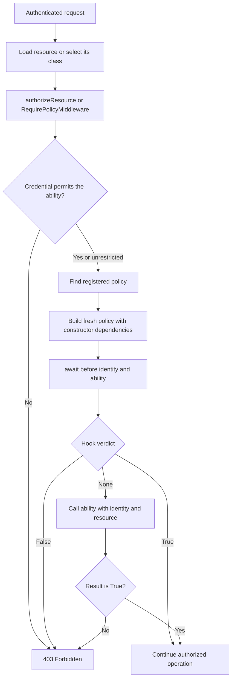

Una policy agrupa decisiones sobre un recurso: consultar un perfil, modificar un registro propio o permitir la creación de una entidad. La autenticación identifica al solicitante; la policy decide si puede realizar una acción sobre ese recurso.

Los [roles y permisos](/es/security/authentication/authorization) expresan capacidades generales. Una policy puede utilizarlos y añadir condiciones como la propiedad de un registro. Cada habilidad es un método elegido por tu aplicación; no hay una lista automática de acciones CRUD.

## Crear una policy

Crea `app/policies/user_policy.py`:

```python
from app.models.user import User
from orionis.auth import Policy
from orionis.auth.contracts.authenticatable import IAuthenticatable
from orionis.auth.contracts.manager import IAuthManager


class UserPolicy(Policy):

    def __init__(self, auth: IAuthManager) -> None:
        self.auth = auth

    async def view(
        self,
        identity: IAuthenticatable,
        member: User,
    ) -> bool:
        if identity.getAuthIdentifier() == member.getAuthIdentifier():
            return True
        return await self.auth.can("users.view")

    async def update(
        self,
        identity: IAuthenticatable,
        member: User,
    ) -> bool:
        if identity.getAuthIdentifier() == member.getAuthIdentifier():
            return True
        return await self.auth.can("users.update")

    async def create(
        self,
        identity: IAuthenticatable,
        resource: type[User],
    ) -> bool:
        return await self.auth.can("users.create")
```

Esta policy protege el modelo `User` del proyecto:

- `view` permite consultar el propio perfil o utilizar el permiso `users.view` para consultar otros.
- `update` permite modificar el propio perfil o utilizar `users.update` para modificar otros.
- `create` recibe la **clase** `User` y exige `users.create`. No necesita un usuario ya creado.

Los permisos se conceden mediante `PermissionRegistrar` como se explica en [Roles y permisos](/es/security/authentication/authorization). Heredar de `Policy` no crea esos permisos ni los asigna automáticamente.

### Firma y dependencias

Las habilidades reciben exactamente `identity` y `resource`, en ese orden. `identity` es la identidad autenticada; `resource` es la instancia o clase que pasaste al evaluador.

La policy admite inyección **por constructor**; en este ejemplo recibe `IAuthManager`. Orionis construye una instancia nueva por evaluación en el ámbito actual. Las habilidades se invocan directamente: no declares parámetros de dependencias adicionales en ellas.

Una habilidad puede ser `def` o `async def`. Debe devolver el booleano `True` para permitir la acción; un objeto verdadero, `1` o una respuesta HTTP no sustituyen ese resultado. Una policy decide acceso; el controlador realiza la operación y genera la respuesta.

## Registrar la policy

Crea `app/providers/authorization_provider.py`:

```python
from app.models.user import User
from app.policies.user_policy import UserPolicy
from orionis.container.providers.service_provider import ServiceProvider
from orionis.support.facades import Auth


class AuthorizationProvider(ServiceProvider):

    async def boot(self) -> None:
        Auth.registerPolicy(User, UserPolicy)
```

`Auth.registerPolicy()` es síncrono. La fachada se importa desde `orionis.support.facades`.

Los providers del directorio predeterminado `app/providers` se descubren al iniciar la aplicación. Si utilizas registro explícito, incorpóralo en `bootstrap/app.py` **antes de** `app.create()`:

```python
from app.providers.authorization_provider import AuthorizationProvider


app.withProviders(AuthorizationProvider)
```

Integra estas líneas en el bootstrap existente; `app` es la instancia de `Application` ya configurada. No registres la policy dentro de cada petición.

El registro relaciona una clase de recurso con una clase que implemente `IPolicy`; `Policy` ya implementa ese contrato. Al buscar una policy también se recorren las clases base del recurso, por lo que una subclase puede utilizar la policy de su antecesor. Registrar una nueva asociación reemplaza la anterior para ese tipo.

## Autorizar un recurso en un controlador

Guarda `app/http/controllers/member_controller.py`:

```python
from app.models.user import User
from orionis.auth.contracts.manager import IAuthManager
from orionis.http import JSONResponse


class MemberController:

    def __init__(self, auth: IAuthManager) -> None:
        self.auth = auth

    async def show(self, user_id: int) -> JSONResponse:
        member = await User.findOrFail(user_id)
        await self.auth.authorizeResource("view", member)

        return JSONResponse({
            "id": member.id,
            "name": member.name,
        })

    async def capabilities(
        self,
        user_id: int,
        auth: IAuthManager,
    ) -> JSONResponse:
        member = await User.findOrFail(user_id)
        await auth.authorizeResource("view", member)

        return JSONResponse({
            "can_update": await auth.allows("update", member),
            "cannot_update": await auth.denies("update", member),
        })
```

`show` carga el usuario solicitado, exige acceso antes de exponer sus datos y devuelve únicamente `id` y `name`. `capabilities` exige primero poder consultar el perfil y devuelve si puede modificarse.

El constructor demuestra inyección de `IAuthManager`; `capabilities` demuestra la misma dependencia mediante inyección de método.

En `routes/api.py`:

```python
from app.http.controllers.member_controller import MemberController
from orionis.auth.middleware import AuthenticateTokenMiddleware
from orionis.support.facades import Route


Route.get("/members/{user_id:int}", [MemberController, "show"]).middleware(
    AuthenticateTokenMiddleware,
)

Route.get(
    "/members/{user_id:int}/capabilities",
    [MemberController, "capabilities"],
).middleware(AuthenticateTokenMiddleware)
```

Prueba con un [token personal](/es/security/authentication/personal-access-tokens) del solicitante:

```bash
curl "http://localhost:8000/members/7" \
  -H "Authorization: Bearer YOUR_TOKEN" \
  -H "Accept: application/json"

curl "http://localhost:8000/members/7/capabilities" \
  -H "Authorization: Bearer YOUR_TOKEN" \
  -H "Accept: application/json"
```

Usa un `user_id` existente y la URL mostrada por el servidor. En rutas web puedes utilizar el mismo controlador con `AuthenticateSessionMiddleware`.

El parámetro `{user_id:int}` llega al controlador como entero. El controlador carga el modelo con `User.findOrFail()`; el router y la policy no lo recuperan automáticamente por el nombre del parámetro.

### La misma API desde la fachada

También puedes utilizar el servicio mediante `Auth`. Guarda `app/http/controllers/own_profile_controller.py` y registra su acción en una ruta autenticada:

```python
from app.models.user import User
from orionis.http import JSONResponse
from orionis.support.facades import Auth


class OwnProfileController:

    async def __call__(self) -> JSONResponse:
        member = await User.findOrFail(Auth.identifier())
        await Auth.authorizeResource("view", member)

        return JSONResponse({
            "id": member.id,
            "can_update": await Auth.allows("update", member),
        })
```

| Método | Uso |
| --- | --- |
| `await Auth.allows(ability, resource)` | Consulta si la policy permite la acción. |
| `await Auth.denies(ability, resource)` | Negación de `allows`. |
| `await Auth.authorizeResource(ability, resource)` | Continúa si hay acceso; lanza una excepción si falta. |

`allows` devuelve `False` para invitados. `authorizeResource` distingue la ausencia de identidad de la denegación de acceso. No confundas `authorize("users.update")`, que exige un permiso, con `authorizeResource("update", member)`, que ejecuta la policy de `member`.

Para modificar datos, autoriza antes de escribirlos. Por ejemplo, una acción que llame a `await member.update(...)` debe ejecutar primero `await Auth.authorizeResource("update", member)`.

## Middleware para habilidades de clase

Cuando la decisión no depende de un registro existente, utiliza `RequirePolicyMiddleware`. Crea `app/http/middleware/can_create_members.py`:

```python
from app.models.user import User
from orionis.auth.middleware import RequirePolicyMiddleware


class CanCreateMembers(RequirePolicyMiddleware):
    ability = "create"
    resource = User
```

En `routes/api.py`, este endpoint proporciona los campos de un formulario solo a quien puede crear usuarios:

```python
from app.http.middleware.can_create_members import CanCreateMembers
from orionis.auth.middleware import AuthenticateTokenMiddleware
from orionis.http import JSONResponse
from orionis.support.facades import Route


async def member_creation_form() -> JSONResponse:
    return JSONResponse({"fields": ["name", "email", "password"]})


Route.get("/members/create", member_creation_form).middleware(
    AuthenticateTokenMiddleware,
    CanCreateMembers,
)
```

El middleware evalúa `UserPolicy.create(identity, User)`. No crea el usuario ni procesa un formulario: la acción protegida hace su trabajo después de que se conceda acceso.

El middleware nativo recibe siempre la **clase** indicada en `resource`; no ofrece un callback para cargar modelos desde parámetros de ruta. Para `update`, `view` u otras habilidades que necesiten un registro, carga la instancia en el controlador y llama a `authorizeResource` allí.

Las mismas clases pueden aplicarse a grupos de rutas. Mantén el middleware de autenticación antes de la comprobación de policy; consulta [Middleware de autenticación](/es/security/authentication/middleware).

## Interceptar decisiones con before

La clase base `Policy` define `async before(identity, ability)` y devuelve `None`. Puedes sobrescribirlo para una condición común a todas las habilidades.

Este ejemplo de clase base deniega las operaciones a cuentas inactivas; una policy concreta puede heredar de ella y declarar sus habilidades:

```python
from orionis.auth import Policy
from orionis.auth.contracts.authenticatable import IAuthenticatable


class ActiveAccountPolicy(Policy):

    async def before(
        self,
        identity: IAuthenticatable,
        ability: str,
    ) -> bool | None:
        if not identity.active:
            return False
        return None
```

El ejemplo supone el atributo `active` del modelo `User` predeterminado.

| Retorno de `before` | Efecto |
| --- | --- |
| `None` | Ejecuta el método de la habilidad solicitada. |
| `True` | Permite sin ejecutar esa habilidad. |
| `False` | Deniega sin ejecutar esa habilidad. |

`before` debe ser asíncrono; el evaluador siempre lo espera. Recibe la identidad y el nombre de la habilidad, sin el recurso. No conviertas un rol llamado `admin` en una excepción implícita: si tu aplicación necesita ese comportamiento, decláralo expresamente en su lógica de policy.

El límite de una credencial se comprueba **antes** del hook. Un `before` que devuelve `True` no puede ampliar las habilidades de un token restringido.

## Policies y tokens personales

El nombre de habilidad también está limitado por `abilities`. Con un token restringido, `allows("update", member)` solo llega a la policy si el token contiene exactamente `"update"`.

La policy decide después. En `UserPolicy`:

- Para modificar el perfil propio, la condición de propiedad permite el acceso si la credencial permite `update`.
- Para modificar el perfil de otro usuario, se exige además `Auth.can("users.update")`. El usuario debe poseer ese permiso y el token restringido debe incluir también `users.update`.

Por tanto, para ese segundo caso el token necesita `["update", "users.update"]` y el usuario necesita `users.update`. Las habilidades no son comodines ni crean permisos. Un token sin restricciones, con `abilities=None`, deja decidir a la policy utilizando la autorización de su identidad.

No existe una comprobación automática de un permiso llamado `update` además de la policy: ese permiso solo se exige si tu código llama a `can` o `authorize` para él.

## Consultar una policy desde las vistas

Pasa la instancia `member` a la plantilla. El global `auth()` permite consultar la misma policy y Jinja espera automáticamente su resultado:

```jinja

  
    <a href="/members/{{ member.id }}/edit">Edit profile</a>
  

```

`/members/{id}/edit` representa una ruta que debes definir en tu aplicación. Mantén la comprobación en el endpoint que modifica el usuario; la plantilla solo decide qué elementos muestra.

## Flujo de autorización



El flujo comienza después de resolver la identidad. `authorizeResource` y el middleware nativo rechazan al invitado antes de evaluar la policy.

Las clases de policies se registran y su búsqueda se reutiliza; las instancias se construyen de nuevo para cada evaluación. Así, una dependencia inyectada pertenece al ámbito vigente. No guardes el usuario actual en atributos de servicios globales.

## Denegaciones y errores de configuración

- **Sin identidad:** `authorizeResource` o el middleware lanzan `AuthenticationException`. El manejador HTTP predeterminado devuelve `401` para esa excepción. El middleware previo de autenticación de sesión puede redirigir al navegador al login antes de llegar a esta comprobación.
- **Identidad sin acceso:** lanzan `AuthorizationException`, que el manejador predeterminado convierte en `403`.
- **Policy sin registrar:** se lanza `PolicyNotFoundException` cuando la evaluación llega a buscarla.
- **Habilidad ausente:** se lanza `PolicyNotFoundException` si `before` delega y el método no existe. Un hook que concede o deniega no necesita ejecutar ese método.
- **Nombre privado o inválido:** `allows` devuelve `False` para nombres que no son identificadores Python, comienzan con `_` o son `before`.
- **Middleware sin `ability` o `resource`:** se lanza `AuthConfigurationException`.

Las excepciones de tu lógica o de sus dependencias se propagan al [manejador HTTP de excepciones](/es/http/exceptions); un error al evaluar una policy no equivale a un booleano `False`. Consulta [Configuración y guards](/es/security/authentication/configuration-and-guards) para resolver la identidad y [Roles y permisos](/es/security/authentication/authorization) para administrar capacidades.
