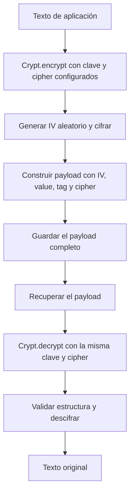

El cifrado permite conservar texto que la aplicación necesita recuperar, por ejemplo una credencial de integración. Orionis lo expone mediante la fachada `Crypt` y el contrato `IEncrypter`. `encrypt()` devuelve un payload cifrado y `decrypt()` recupera el texto original utilizando la clave y el cipher configurados.

Para las contraseñas de acceso, utiliza [hashing](/es/security/hashing): el caso de uso consiste en comprobar un candidato. El cifrado corresponde a valores cuyo contenido debe poder recuperarse.

## Clave, cipher y payload

Estos tres elementos intervienen en cada operación:

| Elemento | Responsabilidad |
| --- | --- |
| `APP_KEY` | Clave que mantiene la aplicación y que se utiliza tanto para cifrar como para descifrar. |
| `APP_CIPHER` | Selecciona la variante AES admitida y determina la longitud de la clave y del IV. |
| Payload devuelto por `encrypt()` | Representa el IV aleatorio, el valor cifrado, el cipher y el tag cuando corresponde. No contiene la clave. |

`config/app.py` configura la clave y el cipher; `config/hashing.py` configura los hashes de contraseñas. Mantén la clave y el cipher con los que se generaron los valores que quieras recuperar.

El payload se codifica como texto Base64 sobre una estructura JSON. Ese envoltorio facilita guardarlo en un campo o transmitirlo como texto; Base64 por sí solo no es el mecanismo de protección. Guarda el resultado completo de `encrypt()`.

## Recorrido de un valor

Un IV nuevo hace que cifrar el mismo texto varias veces pueda producir payloads diferentes. Para recuperar el valor utiliza `decrypt()` sobre el payload almacenado. Una clave distinta o un cipher incompatible no ofrecen un mecanismo de recuperación de los datos anteriores.

La API recibe y devuelve `str`. Para guardar un objeto estructurado, serialízalo explícitamente antes de cifrarlo y deserialízalo después de recuperarlo; la [guía práctica](/es/security/encryption/encrypting-values) incluye el recorrido completo.

## Acceder al servicio

Importa la fachada con `from orionis.support.facades import Crypt`. Sus métodos `Crypt.encrypt(text)` y `Crypt.decrypt(payload)` son **síncronos**, también dentro de un controlador `async`.

Para declarar la dependencia, importa `IEncrypter` desde `orionis.encrypter.contracts` y recíbelo en el constructor o en la acción. El proveedor integrado registra una instancia compartida durante el arranque de la aplicación.

Consulta [cifrar y descifrar valores](/es/security/encryption/encrypting-values) para copiar ejemplos completos con controladores, schemas, rutas e inyección de dependencias.

## Variantes disponibles

| Cipher | Clave | Comprobación de integridad implementada |
| --- | --- | --- |
| `AES-128-CBC` | 16 bytes | La variante CBC no añade MAC ni tag de autenticación al payload. |
| `AES-256-CBC` | 32 bytes | La variante CBC no añade MAC ni tag de autenticación al payload. Es el valor predeterminado de la configuración. |
| `AES-128-GCM` | 16 bytes | Genera y verifica el tag de autenticación GCM. |
| `AES-256-GCM` | 32 bytes | Genera y verifica el tag de autenticación GCM. |

El servicio comprueba el formato y que el cipher del payload coincida con el configurado. Esas comprobaciones no convierten un payload CBC en un mensaje autenticado. El tag de GCM forma parte de la operación de descifrado.

La [guía de valores y claves](/es/security/encryption/encrypting-values) detalla los comandos `key:generate`, la configuración, el formato de salida, los errores que puedes manejar y las implicaciones de cambiar la clave. La recuperación y sustitución de valores existentes requiere un proceso explícito de tu aplicación.
