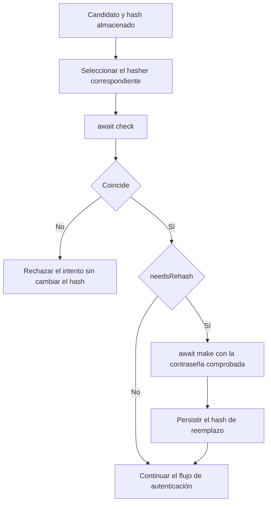

El hashing de contraseñas transforma una contraseña en un valor codificado que puedes guardar y comprobar posteriormente. La aplicación conserva ese hash y verifica cada candidato mediante `check()`. Este proceso permite comprobar la contraseña sin disponer de una operación para recuperarla.

Orionis ofrece este servicio mediante la fachada `Hash` y el contrato `IHashManager`. El driver predeterminado es `argon2`, que genera hashes **Argon2id**; también se incluye `bcrypt`. Ambos delegan el cálculo en un hilo de trabajo para que `make()` y `check()` puedan utilizarse desde acciones asíncronas.

## Elegir hashing o cifrado

| Necesidad | Servicio | Resultado |
| --- | --- | --- |
| Guardar una contraseña y comprobar futuros intentos | `Hash` | Hash codificado con algoritmo, parámetros y salt. |
| Conservar un texto que tu aplicación debe recuperar | `Crypt` | Payload cifrado que requiere la clave de aplicación para descifrarse. |

La [guía de cifrado](/es/security/encryption) explica el segundo caso. La codificación Base64 se utiliza para representar datos, pero por sí sola no los protege.

La clave `APP_KEY` pertenece al cifrado. Los drivers de hashing utilizan sus propios parámetros y el salt que genera el backend; no requieren que aportes un salt ni usan esa clave de aplicación para comprobar contraseñas.

## Qué hace cada operación

| Operación | Uso |
| --- | --- |
| `await Hash.make(password)` | Genera el hash que guardarás en el registro del usuario. |
| `await Hash.check(candidate, stored_hash)` | Comprueba un candidato frente al hash guardado y devuelve `bool`. |
| `Hash.needsRehash(stored_hash)` | Comprueba si el hash necesita renovarse según el driver y sus parámetros actuales. |
| `Hash.driver("bcrypt")` | Selecciona explícitamente un hasher cuando conoces el algoritmo de un registro. |

Importa la fachada con `from orionis.support.facades import Hash`. Las operaciones de cálculo llevan `await`; `needsRehash()` y `driver()` son síncronas una vez iniciada la aplicación. También puedes inyectar `IHashManager` desde `orionis.hashing.contracts` en un constructor o en una acción.

El proveedor integrado registra el servicio durante el arranque de Orionis. Los ejemplos de la [guía práctica](/es/security/hashing/password-storage) utilizan una aplicación real, schemas HTTP y controladores; no necesitas crear un gestor de hashes en cada petición.

## Del registro a la comprobación

1. Valida los datos recibidos y la política de contraseña.
2. Genera el hash con `await Hash.make(...)`.
3. Guarda el resultado completo en el campo de contraseña.
4. En un intento posterior, recupera el hash almacenado.
5. Comprueba el candidato con `await Hash.check(candidate, stored_hash)`.
6. Si la comprobación es correcta y `needsRehash()` lo solicita, genera un reemplazo usando la contraseña comprobada y persístelo.

Dos llamadas a `make()` para la misma contraseña pueden producir hashes distintos porque incorporan un salt aleatorio. Utiliza `check()` para verificarla; comparar directamente un hash recién generado con el almacenado no implementa ese proceso.

`needsRehash()` inspecciona el formato y los costes; no verifica al usuario ni modifica la base de datos. El gestor de hashing tampoco registra cuentas, crea sesiones o limita intentos. Para implementar el acceso con los guards del framework, continúa con [autenticación](/es/security/authentication).

## Drivers y configuración

| Driver | Algoritmo generado | Configuración principal |
| --- | --- | --- |
| `argon2` | `argon2id` | Memoria en KiB, paralelismo e iteraciones. |
| `bcrypt` | `bcrypt` | Factor de coste `rounds`. |

`config/hashing.py` selecciona el driver y sus costes. Cambiar `HASH_DRIVER` afecta las operaciones que utilizan el predeterminado; no convierte los hashes existentes ni hace que `check()` detecte otros algoritmos automáticamente.

La [guía de generación y verificación](/es/security/hashing/password-storage) cubre:

- Registro y comprobación desde controladores.
- Fachada e inyección por constructor y método.
- Todas las opciones de `config/hashing.py` y sus variables de entorno.
- Costes por llamada, consulta de algoritmos y setters disponibles.
- Rehash después de una comprobación correcta y migración explícita desde bcrypt.
- Dependencias, excepciones y límites de los drivers.

Para guardar valores recuperables y gestionar sus claves, consulta [cifrado de datos](/es/security/encryption).
