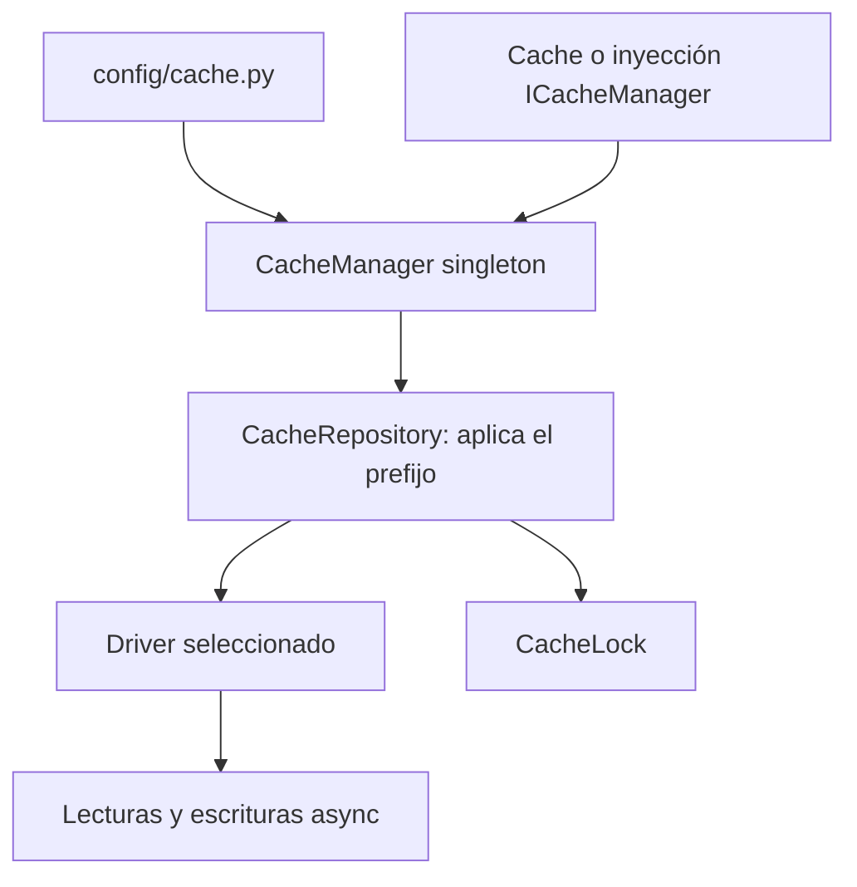

Utiliza la caché para resultados que puedes reconstruir: consultas frecuentes, resúmenes o cálculos costosos. Define cuánto tiempo puede quedar desactualizado un valor y cuándo invalidarlo. La base de datos conserva la información permanente; la caché evita repetir trabajo.

## Primera operación desde un controlador

Empieza con el almacenamiento en archivos incluido en la instalación normal. Configura estos valores en el `.env` de tu aplicación antes del arranque:

```dotenv
CACHE_STORE=file
CACHE_PREFIX=my-app
```

El directorio predeterminado es `storage/framework/cache/data` y el proceso de la aplicación debe poder escribir allí. Este almacenamiento no requiere Redis ni un paquete adicional de caché. `config/cache.py` define los almacenes disponibles y sus opciones.

Importa la fachada desde `orionis.support.facades`. Este controlador guarda un resumen durante cinco minutos y recupera el valor:

```python
from orionis.http import JSONResponse
from orionis.support.facades import Cache


class CacheExampleController:
    async def __call__(self) -> JSONResponse:
        key = "catalog:summary:v1"
        await Cache.set(key, {"products": 42}, ttl=300)
        return JSONResponse(await Cache.get(key))
```

Registra la acción en el archivo de rutas configurado:

```python
from app.http.controllers.cache_example_controller import CacheExampleController
from orionis.support.facades import Route

Route.get("/cache-example", CacheExampleController)
```

Guarda el controlador en `app/http/controllers/cache_example_controller.py`. Tras expirar o eliminarse la entrada, `get()` devuelve `None`. Para calcular solo cuando falta el valor, utiliza `remember()` en la [guía de operaciones](/es/services/cache/caching-values#repository-remember).

## Cómo se organiza el servicio



El manager selecciona uno de los cinco almacenes nativos y conserva su repositorio. La fachada delega al mismo servicio que resuelve el contenedor. Las operaciones de valores son asíncronas; las factorías `store()` y `lock()` son síncronas. Cuando tu primera operación con la fachada sea seleccionar un almacén, resuelve antes `cache = await Cache.resolve()` y después usa `cache.store("memory")`. El provider es diferido: importar `Cache` o iniciar la aplicación no garantiza haberlo resuelto. Los métodos asíncronos como `await Cache.get(...)` hacen esa resolución al esperarse.

`FileBasedCache` es una API síncrona independiente para artefactos derivados de archivos fuente. No es el driver `file` ni utiliza su TTL o prefijo.

## Elegir el siguiente paso

- [Drivers y dependencias](/es/services/cache/stores-and-locks): ventajas, límites y servicios externos de las cinco opciones.
- [Configuración](/es/services/cache/configuration): todas las propiedades, variables de entorno y valores predeterminados.
- [Guardar y regenerar valores](/es/services/cache/caching-values): API completa del repositorio, TTL, lotes y contadores.
- [Bloqueos y concurrencia](/es/services/cache/locks): contextos, espera y garantías de cada backend.
- [Artefactos de código fuente](/es/services/cache/source-artifacts): invalidación por fuentes y serialización enriquecida.
- [Fachada e inyección](/es/services/cache/manager-and-injection): uso en controladores, servicios y providers.
- [Referencia técnica](/es/services/cache/api-reference): contratos, backends, factorías, errores e inventario verificable.
