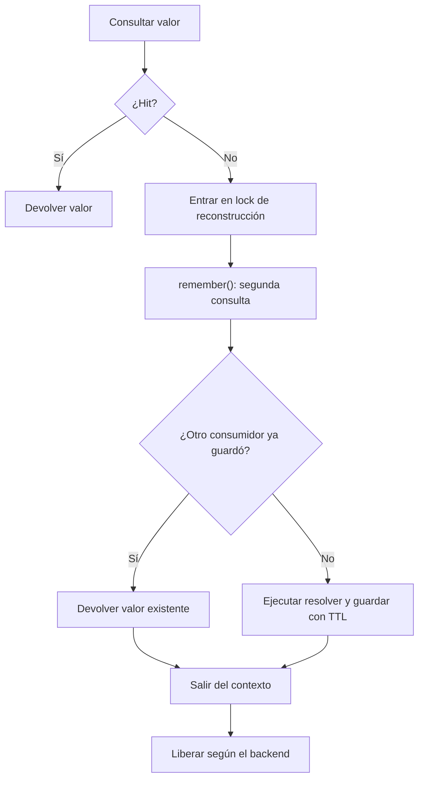

Un bloqueo de caché coordina a los consumidores que utilizan la misma clave, store y prefijo. Su alcance depende del backend: el store `file` coordina tareas del mismo event loop; los demás utilizan leases o filas de base de datos con garantías distintas. No convierte una secuencia de caché en una transacción de negocio.

Para elegir y configurar el backend consulta [stores](/es/services/cache/stores-and-locks) y [configuración](/es/services/cache/configuration). Esta página desarrolla el funcionamiento real de los bloqueos y su uso para reducir reconstrucciones duplicadas.

## Obtener un bloqueo

<a id="lock-construction"></a>
Las implementaciones concretas exponen estas firmas:

```text
CacheManager.lock(key: str, timeout: float | None = None) -> Any
CacheRepository.lock(key: str, timeout: float | None = None) -> CacheLock
CacheLock(backend: Any, key: str, timeout: float | None = None) -> None
```

`CacheManager.lock()` utiliza el store predeterminado. `CacheRepository.lock()` utiliza el store seleccionado y antepone el prefijo de claves del repositorio. Ambos construyen un objeto síncronamente: **no adquieren el bloqueo todavía**. El constructor de `CacheLock` recibe un backend interno; normalmente no necesitas utilizarlo directamente.

Resuelve primero el manager para obtener un repositorio síncrono: `cache = await Cache.resolve()` y después `cache.store("file")`. Esto también funciona cuando el provider diferido aún no se ha resuelto. No encadenes `Cache.store(...).lock(...)` suponiendo que la fachada ya está fijada. Consulta [manager e inyección](/es/services/cache/manager-and-injection).

Los contratos `ICacheManager` e `ICacheRepository` no declaran `lock()`, aunque las clases concretas lo implementan. No existe una API pública de `CacheLock` con métodos `acquire()`, `release()`, `forceRelease()`, renovación del lease ni consulta del propietario. Su API de adquisición y liberación es el contexto asíncrono.

<a id="lock-context"></a>
### Entrar y salir del contexto

```text
async __aenter__() -> Self
async __aexit__(
    exc_type: type[BaseException] | None,
    exc_val: BaseException | None,
    exc_tb: types.TracebackType | None,
) -> None
```

`async with repository.lock(key, timeout=...) as acquired` devuelve la misma instancia de `CacheLock`; no devuelve un booleano que confirme propiedad distribuida. El bloque comienza cuando termina la estrategia de adquisición del backend. La salida libera según esa estrategia, también si el bloque termina con una excepción, y no la suprime. Un fallo al entrar impide ejecutar el bloque y no ejecuta su `__aexit__()`.

### Actualizar un valor bajo el bloqueo file

Este controlador coordina tareas del mismo event loop y directorio de caché. Sus operaciones de lectura y escritura comparten el bloqueo de aplicación; otros escritores deben utilizar la misma clave para participar:

```python
from orionis.http import JSONResponse
from orionis.support.facades import Cache


class RefreshCounterController:
    async def refresh(self) -> JSONResponse:
        cache = await Cache.resolve()
        repository = cache.store("file")
        try:
            async with repository.lock("reports:refresh-counter", timeout=2.0):
                current = await repository.get("reports:refresh-count")
                updated = int(current or 0) + 1
                await repository.set("reports:refresh-count", updated, ttl=60)
                return JSONResponse({"refreshes": updated})
        except TimeoutError:
            return JSONResponse(
                {"error": "Refresh is busy; retry later"},
                status_code=503,
                headers={"Retry-After": "2"},
            )
```

Guárdalo en `app/http/controllers/refresh_counter_controller.py` y asocia una ruta POST a `refresh`. El `except` trata un `TimeoutError` de todo el contexto; si introduces operaciones con sus propios timeouts dentro del bloque, distingue sus errores cuando necesites otra respuesta. El bloqueo no revierte `set()` si una operación posterior falla.

<a id="lock-timeouts"></a>
## Qué significa timeout en cada backend

Una **espera máxima** limita cuánto espera el consumidor para entrar. Un **lease** limita cuánto tiempo dura la reserva del propietario; al vencer, su código puede seguir ejecutándose mientras otro consumidor entra. La API utiliza un solo argumento `timeout`, pero no ofrece esos dos controles por separado.

| Store | Implementación y alcance | `timeout=None` | `timeout` positivo |
| --- | --- | --- | --- |
| `file` | `asyncio.Lock` por event loop, directorio canónico y clave prefijada. | Espera sin plazo; no tiene lease automático. | Límite de espera para `acquire()`; no limita la duración del bloque. |
| `database` | Fila con clave única, propietario y vencimiento en la tabla configurada. | Espera sin plazo, con lease de 10 segundos. | Se utiliza tanto como plazo de espera como lease tras adquirir. |
| `memory` | `aiocache.RedLock` sobre la instancia de caché del proceso. | Lease de 10 segundos. | Lease y espera del evento local; vencer esa espera no lanza un error de contención. |
| `redis` | `aiocache.RedLock` sobre una instancia Redis. | Lease de 10 segundos. | Igual estrategia RedLock; no es exclusión estricta de recursos. |
| `memcached` | `aiocache.RedLock` con liberación sin comparación atómica de propietario. | Lease de 10 segundos. | Igual estrategia RedLock; utiliza segundos enteros admitidos por el cliente. |

Utiliza un valor estrictamente positivo o `None`. No hay validación común que normalice todos los valores: `0` no significa «intentar sin esperar» de manera portable. File puede lanzar `TimeoutError` incluso con el recurso libre; database realiza un intento con lease de 10 segundos y después comprueba su plazo; RedLock sustituye `0` por 10 segundos. Un valor negativo tampoco tiene un significado útil uniforme.

En Memcached el cliente puede rechazar un `float` como tiempo de expiración; utiliza, por ejemplo, `timeout=5`, en vez de `5.0`. Redis transforma leases `float` en milisegundos; evita valores positivos tan pequeños que se conviertan en cero. Estos tiempos son independientes del TTL de los datos guardados y del timeout de las operaciones del cliente de red.

<a id="lock-file"></a>
### File: alcance del bloqueo de aplicación

Los objetos que apuntan al mismo directorio resuelto, clave y event loop comparten un `asyncio.Lock`. Instancias con directorios diferentes o event loops distintos no comparten ese bloqueo. El registro utiliza referencias débiles para que los locks sin participantes no se acumulen.

El backend file también utiliza `FileLock` internos para ciertas mutaciones atómicas de sus archivos. Esos locks internos pueden coordinar procesos durante una operación individual, pero **no amplían** `repository.lock()` para proteger un bloque completo entre workers. No confundas ambos niveles.

<a id="lock-database"></a>
### Database: propietario y vencimiento

```text
async acquireLock(key: str, owner: str, lease: float) -> bool
async releaseLock(key: str, owner: str) -> None
```

La adquisición genera un token UUID y llama a `DatabaseCacheBackend.acquireLock(key, owner, lease)`. El backend intenta insertar una fila; si existe, puede actualizarla solo cuando pertenece al mismo propietario o ya venció. Devuelve `True` si obtuvo la fila y `False` si continúa ocupada. `CacheLock` repite el intento cada 0,05 segundos hasta conseguirla o detectar que venció el plazo; no garantiza orden FIFO ni un límite exacto de espera que excluya el tiempo de I/O.

El lease se calcula con `time.time()` del proceso que adquiere la fila. Compartir conexión, tabla y clave permite coordinar consumidores de distintos procesos mientras el lease sigue vigente; considera sus relojes y la duración de la operación. No se renueva automáticamente. El backend exige restricciones únicas realmente aplicadas y rechaza conexiones que no las garantizan, como Redshift.

`releaseLock(key: str, owner: str) -> None` elimina únicamente una fila que todavía tiene ese propietario. Si el lease venció y otro consumidor la adquirió, la salida del primero no elimina la reserva del segundo. El objeto público no expone el token; no accedas a sus atributos privados para transferir propiedad.

Estas dos primitivas del backend son async y están detrás del contexto; no es necesario llamarlas al utilizar `repository.lock()`. Los errores de actualización, liberación o conexión pueden propagarse. En adquisición, un `QueryException` del INSERT deriva en un intento de UPDATE; si este no cambia filas, la operación puede devolver `False` en vez de exponer el error inicial. La implementación no coordina tu transacción de negocio con la fila del lock.

<a id="lock-redlock"></a>
### Memory, Redis y Memcached: comportamiento RedLock

La implementación instalada de `aiocache.RedLock` intenta añadir una clave con sufijo `-lock`, un token aleatorio y un lease. Si ya existe, espera un evento del **proceso local**. Después de esa espera no vuelve a intentar adquirir la clave.

Consecuencias verificadas del flujo:

- Si vence el lease/tiempo de espera, los consumidores pendientes pueden entrar simultáneamente, sin una nueva adquisición. Ese vencimiento de contención se absorbe; no se convierte en `TimeoutError` para tu controlador.
- Si no existe un evento local para una clave ocupada —por ejemplo, porque la creó otro proceso— la espera puede terminar inmediatamente. Un backend remoto no transforma este comportamiento en exclusión distribuida estricta.
- Memory coordina solo esa instancia/proceso. Redis utiliza una comprobación y eliminación atómicas por token para liberar; ese mecanismo protege la liberación, pero no corrige la entrada de consumidores descrita antes.
- Memcached elimina la clave sin comparar atómicamente su token; una salida puede eliminar la reserva de otro propietario. No utilices este lock para operaciones cuya corrección dependa de propiedad exclusiva.

El registro de eventos de RedLock se comparte por clave final dentro del proceso, sin identificar el cliente/backend. Si utilizas clientes o stores independientes, asigna nombres de lock distintos: reutilizar la misma clave final entre instancias puede interferir en la liberación y propagar `KeyError`.

Esta estrategia reduce trabajo duplicado cuando resulta aceptable volver a calcular un resultado; no constituye un mecanismo de garantía para pagos, unicidad de registros u otras invariantes. Para esas invariantes utiliza las restricciones y transacciones apropiadas de la base de datos.

## Evitar reconstrucciones duplicadas con doble comprobación

`remember()` por sí solo lee, calcula y guarda; no utiliza `lock()`. Dos misses simultáneos pueden ejecutar el resolver. Primero consulta el valor para evitar adquirir el bloqueo en un hit; después, **dentro** del contexto, llama a `remember()` para volver a comprobar antes de reconstruir.

Este controlador calcula un resumen de archivos del disco local. Guarda un diccionario, por lo que un `None` exterior representa un miss válido para este caso:

```python
from orionis.http import JSONResponse
from orionis.support.facades import Cache, Storage


class DocumentSummaryController:
    async def show(self) -> JSONResponse:
        cache = await Cache.resolve()
        repository = cache.store("file")
        key = "documents:summary"
        cached = await repository.get(key)
        if cached is not None:
            return JSONResponse(cached)

        try:
            async with repository.lock("documents:summary:build", timeout=3.0):
                value = await repository.remember(key, 60, self._build)
                return JSONResponse(value)
        except TimeoutError:
            return JSONResponse({"error": "Summary is being rebuilt"}, status_code=503)

    async def _build(self) -> dict[str, int]:
        storage = await Storage.resolve()
        files = await storage.disk("local").directory("documents").allFiles()
        return {"files": len(files), "bytes": sum([await file.size() for file in files])}
```

En el store `file` de este ejemplo, el segundo chequeo lo realiza `remember()` con un sentinel interno y distingue un `None` almacenado de una clave ausente. Ese comportamiento no es uniforme: los backends aiocache memory/Redis/Memcached sustituyen un `None` leído por el default y pueden volver a ejecutar el resolver. Consulta [valores de caché](/es/services/cache/caching-values). La comprobación exterior con `get()` no ofrece esa distinción, aunque no afecta al diccionario de este ejemplo. Un resolver sync se ejecuta directamente; usa un resolver async para I/O o desplaza el trabajo bloqueante a un hilo.



Esta combinación mantiene las garantías del backend elegido: file solo coordina el event loop correspondiente y un lease agotado no impide que dos resolvers trabajen a la vez en RedLock/database. No promete ejecución única en todos los escenarios.

### Utilizar inyección de dependencias

Un servicio puede recibir el manager real en el constructor y seleccionar el repositorio, sin acceder a la fachada:

```python
from collections.abc import Awaitable, Callable
from orionis.cache.contracts.cache_manager import ICacheManager
from orionis.cache.repository import CacheRepository


class CachedSummary:
    def __init__(self, cache: ICacheManager) -> None:
        self.cache = cache

    async def get(self, resolver: Callable[[], Awaitable[dict]]) -> dict:
        repository: CacheRepository = self.cache.store("file")
        async with repository.lock("summary:build", timeout=3.0):
            return await repository.remember("summary:value", 60, resolver)
```

Inyecta el servicio en una acción y suministra el resolver de tu aplicación. `lock()` se invoca sobre `CacheRepository`, cuya implementación concreta se verificó; no se añade un método inexistente al contrato.

## Excepciones, cancelación y liberación

File utiliza `asyncio.wait_for()` cuando se indicó un timeout: si vence antes de adquirir, propaga `TimeoutError`. Database lanza `TimeoutError` al detectar su plazo después de un intento fallido. RedLock absorbe el vencimiento de su espera por contención, pero errores del backend, validación, red o timeouts propios del cliente pueden propagarse igualmente.

Si cancelas una tarea que espera un lock file, la espera termina sin liberar el lock de su propietario. Si la cancelación sucede dentro del bloque, `async with` ejecuta su salida: file libera su `asyncio.Lock` sin I/O; database y RedLock deben esperar operaciones de liberación. Esas operaciones no están protegidas de manera uniforme frente a cancelaciones repetidas o errores de backend. Una adquisición remota que complete al mismo tiempo que se cancela la entrada puede depender de que venza su lease para quedar disponible.

No suprimas `CancelledError` para continuar como si hubieras adquirido. Usa un objeto de contexto por participante y evita adquisiciones anidadas de la misma clave: estos locks no proporcionan reentrada por tarea. No dependen de un destructor que libere automáticamente, ni la salida de un proceso ejecuta necesariamente `__aexit__()`.

Si falla la liberación, su excepción se propaga y puede sustituir al error del bloque. Un lease no deshace trabajo ya realizado, un bloqueo no impide que código externo escriba sin participar y ningún contexto de esta API confirma o revierte transacciones de base de datos. Para las operaciones de caché disponibles consulta la [referencia de API](/es/services/cache/api-reference).
