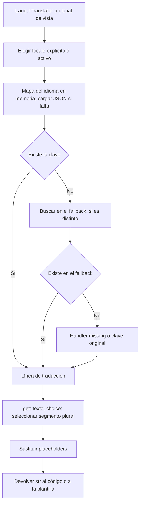

La localización permite que tu aplicación muestre un mensaje en distintos idiomas sin repetir el texto en cada controlador o plantilla. Orionis carga archivos JSON, resuelve claves, aplica reemplazos y selecciona formas plurales mediante un traductor compartido.

El componente `orionis/localization` es el motor de traducciones. Las vistas lo utilizan a través de globals de Jinja, y el mismo servicio está disponible en controladores, comandos y otros servicios de la aplicación.

## Tu primera traducción

Crea `resources/lang/en/quickstart.json`:

```json
{
  "greeting": "Hello :name"
}
```

Crea `resources/lang/es/quickstart.json`:

```json
{
  "greeting": "Hola :name"
}
```

La clave `quickstart.greeting` combina el nombre del archivo y su entrada. Con la configuración predeterminada, Orionis busca estos recursos en `resources/lang`, relativo a la raíz del proyecto.

Guarda `app/http/controllers/quick_translation_controller.py`:

```python
from orionis.http import JSONResponse, response
from orionis.support.facades import Lang


class QuickTranslationController:
    async def show(self, language: str) -> JSONResponse:
        if language not in {"en", "es"}:
            return response.json(
                {"message": "Unsupported language."},
                status_code=422,
            )

        return response.json(
            {
                "message": Lang.get(
                    "quickstart.greeting",
                    locale=language,
                    name="Ada",
                ),
            },
            headers={"Content-Language": language},
        )
```

En `routes/api.py`, cargado mediante la configuración existente `app.withRouting(api="routes/api.py", ...)`:

```python
from app.http.controllers.quick_translation_controller import QuickTranslationController
from orionis.support.facades import Route

Route.get("/hello/{language:slug}", [QuickTranslationController, "show"])
```

Con la aplicación iniciada, `GET /hello/es` devuelve `{"message":"Hola Ada"}` y `GET /hello/en` devuelve `{"message":"Hello Ada"}`. Un código con formato válido pero fuera de la lista, como `fr`, devuelve `422` porque así lo decide este controlador. La anotación `slug` controla el formato del segmento; la lista `{"en", "es"}` decide qué idiomas admite el ejemplo.

`Lang.get()` es **síncrono**: no se espera con `await`, aunque se llame desde una acción asíncrona. El primer acceso a un idioma puede leer sus archivos; después se utiliza su mapa en memoria.

## Tres formas de utilizar el mismo traductor

| Punto de uso | API | Cuándo utilizarla |
| --- | --- | --- |
| Código de aplicación con providers iniciados | `Lang.get("quickstart.greeting", locale="es", name="Ada")` | Acceso mediante la fachada pública. |
| Constructor o método resuelto por el contenedor | `ITranslator` y `translator.get(...)` | Declarar la dependencia del servicio o controlador. |
| Plantilla dentro de `resources/views` | `{{ trans("quickstart.greeting", locale=page_language, name="Ada") }}` | Traducir durante el renderizado con el idioma recibido en el contexto. |

La fachada se importa con `from orionis.support.facades import Lang`. El contrato se importa desde `orionis.localization.contracts.translator`. Los globals `trans`, `__`, `choice`, `locale` y `locales` están registrados por el provider de vistas. Consulta [Fachada, inyección y vistas](/es/services/localization/application-and-views) para ejemplos completos de cada alternativa.

## Idioma de la aplicación e idioma de una petición

`config/app.py` establece `locale`, `fallback_locale` y `language_path`. El idioma activo pertenece al traductor compartido por proceso; no se selecciona automáticamente a partir de `Accept-Language`, la URL o una sesión.

Cuando una petición elige su idioma, valídalo según los idiomas que tu aplicación ofrece y pásalo como `locale=` a cada traducción. En las vistas utiliza una variable como `page_language`. `setLocale()` cambia el estado compartido y puede afectar a otras peticiones concurrentes.

El fallback es un idioma configurado para claves ausentes. No se deduce una cadena regional: `es-CO` no implica probar `es`. Los formatos y valores reales están en [Archivos, idiomas y configuración](/es/services/localization/messages-and-locales).

## Cómo se resuelve un mensaje



Las traducciones son texto. El traductor no escapa HTML, no formatea automáticamente fechas o monedas y no aplica reglas plurales ICU/CLDR. En una vista HTML, el escape corresponde al motor de vistas.

## Recorrido de la guía

- [Archivos e idiomas](/es/services/localization/messages-and-locales): JSON agrupado o literal, directorios, precedencia y configuración.
- [Mensajes y plurales](/es/services/localization/translating-content): `get`, `has`, reemplazos, fallback y selectores de `choice`.
- [Fachada, inyección y vistas](/es/services/localization/application-and-views): uso desde controladores, servicios y plantillas.

Para componer páginas HTML, continúa con [Vistas](/es/services/views).
