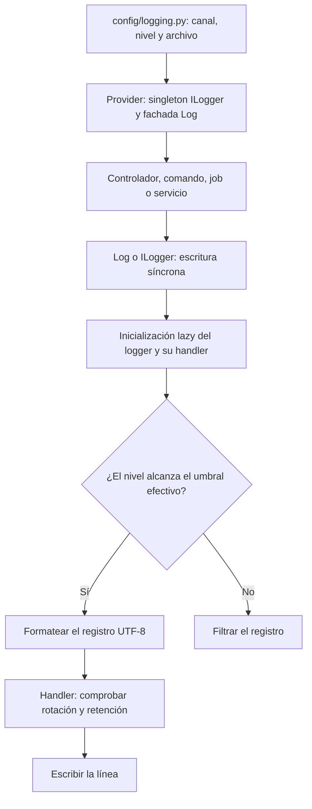

El sistema de logs permite seguir el comportamiento de una petición, un comando o un job mediante eventos con distintos niveles de severidad. Orionis incluye un servicio `Logger`, el contrato `ILogger` y la fachada `Log`: las tres formas de acceso pertenecen al mismo componente.

El servicio escribe archivos de texto UTF-8 y utiliza un canal activo por proceso. La configuración ofrece seis canales: `stack`, `hourly`, `daily`, `weekly`, `monthly` y `chunked`. **`stack` es un archivo único**, no una agrupación de canales. El componente no requiere instalar un driver adicional.

## Empezar a registrar

En el `.env` de tu proyecto puedes seleccionar el canal y su umbral de severidad:

```dotenv
LOG_CHANNEL=daily
LOG_LEVEL=INFO
LOG_RETENTION=int:7
```

El archivo `config/logging.py` lee estas variables durante la configuración. No uses `Env` desde los controladores para configurar el logger: consume el servicio que la aplicación ya preparó. [Canales y configuración](/es/services/logging/configuration) explica cada variable, los valores predeterminados y la ubicación de los archivos.

Después del arranque de la aplicación, puedes utilizar la fachada desde un controlador:

```python
from orionis.http import JSONResponse
from orionis.support.facades import Log


class ReportStatusController:
    async def index(self) -> JSONResponse:
        Log.info("event=report-status-read")
        return JSONResponse({"status": "ready"})
```

En tu archivo de rutas API:

```python
from app.http.controllers.report_status_controller import ReportStatusController
from orionis.support.facades import Route


Route.get("/reports/status", [ReportStatusController, "index"])
```

Guarda el controlador en `app/http/controllers/report_status_controller.py`. Con el canal diario, un registro de ejemplo tiene esta forma:

```text
2026-10-23 10:30:00 [INFO]: event=report-status-read
```

El archivo sigue el patrón `storage/logs/daily_YYYY-MM-DD.log`, relativo a la raíz del proyecto. El provider fija la fachada durante su boot asíncrono; una vez completado ese arranque, `Log.info()` es una llamada **síncrona**, incluso desde un método `async`. No añadas `await`. Para integraciones que acceden antes de ese boot, consulta [el despacho de la fachada](/es/services/logging/writing-logs#logger-facade).

## Del componente al archivo



En los handlers rotativos, la comprobación sucede antes de escribir la línea; no hay un proceso independiente que rote archivos a una hora fija. El logger estándar del proceso se llama `__orionis__` y no propaga registros al logger raíz de Python.

## Elegir la guía

| Necesidad | Guía |
| --- | --- |
| Seleccionar canal, nivel y directorio | [Canales y configuración](/es/services/logging/configuration). |
| Usar todos los métodos, inyectar ILogger o registrar una excepción | [Escribir logs](/es/services/logging/writing-logs). |
| Comprender sufijos, conservación, compresión, cierre y varios workers | [Rotación y ciclo de vida](/es/services/logging/rotation-and-lifecycle). |

La retención limita **cantidades de archivos**, incluso cuando el ajuste se llama `retention_days` o `retention_hours`; no elimina un archivo al alcanzar una antigüedad exacta. La implementación de `chunked` genera un sufijo nuevo en cada registro y puede rotar sin alcanzar `mb_size`. Revisa [el comportamiento de las políticas](/es/services/logging/rotation-and-lifecycle) antes de elegirlas.

El manejo y la presentación de excepciones se documentan en [Excepciones](/es/architecture/exception-handling). Esa sección explica cuándo el handler reporta un error; aquí se explica cómo se escribe y conserva ese registro.

El [inventario verificable de Logs](/downloads/logging-api-inventory.json) relaciona sus declaraciones públicas con las referencias de estas guías.
