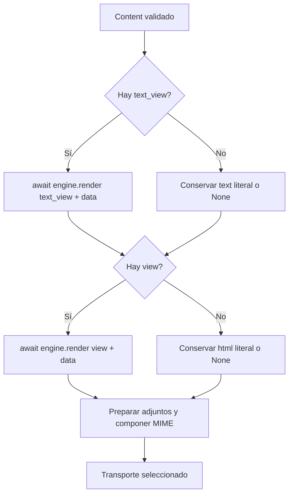

`Content` declara los cuerpos de un correo. Puede contener texto literal, HTML literal, una vista HTML, una vista de texto o una combinación HTML/texto. El compositor convierte esa declaración en partes MIME antes de utilizar el transporte. No devuelve una respuesta HTTP ni procesa plantillas al construir el objeto.

Para organizar una notificación reutilizable, devuelve `Content` desde [`Mailable.content()`](/es/services/mail/composing-mail#mailable-content). También puedes pasar un `Content` directamente a `send()`; sus variantes y callbacks están en [envío y resultados](/es/services/mail/sending-and-results).

<a id="content"></a>
## Declaración completa de Content

Todos los argumentos son opcionales y por nombre, pero debes declarar al menos un cuerpo:

```text
Content(
    *,
    view: str | None = None,
    html: str | None = None,
    text: str | None = None,
    text_view: str | None = None,
    data: Mapping[str, object] | None = None,
)
```

`Content` es un dataclass inmutable. No tiene métodos fábrica: se construye directamente con estas cinco propiedades. `None` significa que esa fuente no se ha declarado. Los cuerpos e identificadores deben ser cadenas; no aceptan `bytes`, `Response`, esquemas de respuesta ni objetos de vista pendientes.

<a id="content-text"></a>
### `text`: texto literal

Úsalo para mensajes de texto plano y alternativas sencillas que no necesitan una plantilla. Se conserva literalmente, sin interpretar Jinja ni escapar HTML:

```python
from orionis.mail import Content

content = Content(text="Your report is ready. Reference: REPORT-1042.")
assert content.text == "Your report is ready. Reference: REPORT-1042."
literal = Content(text="The marker {{ name }} is literal text.")
assert "{{ name }}" in literal.text
```

Una cadena `""` es un cuerpo válido, aunque vacío. Un correo con solo `text` se compone como `text/plain`.

<a id="content-html"></a>
### `html`: HTML literal

Úsalo cuando ya tienes el HTML final. No se renderiza con Jinja ni recibe los valores de `data`. Si interpolas datos externos manualmente, escapa los valores destinados a texto HTML:

```python
from html import escape
from orionis.mail import Content

name = "Ana & Luis"
content = Content(
    html=f"<p>Welcome, {escape(name)}.</p>",
    text=f"Welcome, {name}.",
)
assert "Ana &amp; Luis" in content.html
assert "Ana & Luis" in content.text
```

Solo `html` produce `text/html`; `html` junto con `text` produce `multipart/alternative`. El framework no obtiene automáticamente una versión de texto a partir del HTML.

<a id="content-view"></a>
### `view`: vista para la alternativa HTML

El compositor solicita al motor de vistas que renderice el identificador con `data`. El resultado se utiliza como HTML:

```python
from orionis.mail import Content

content = Content(
    view="emails.welcome",
    text="Welcome, Ana.",
    data={"name": "Ana"},
)
assert content.view == "emails.welcome"
```

Con el motor Jinja predeterminado, `emails.welcome` resuelve `emails/welcome.html` dentro de las rutas configuradas de vistas. No combines `view` con `html`: ambas intentan definir la misma alternativa y el constructor lanza `MailCompositionException`, incluso si el HTML literal es `""`.

<a id="content-text_view"></a>
### `text_view`: vista para la alternativa de texto

Úsalo para un texto plano con condiciones, bucles o más contenido del que conviene mantener en una cadena Python:

```python
from orionis.mail import Content

content = Content(
    view="emails.welcome",
    text_view="emails/welcome.txt",
    data={"name": "Ana", "features": ["Projects", "Reports"]},
)
assert content.text_view == "emails/welcome.txt"
```

`text_view` puede usarse solo o junto con `view` o `html`. No puede combinarse con `text`. El mismo `data` alimenta ambas vistas; el compositor renderiza primero `text_view` y luego `view`.

Para conservar una extensión distinta de `.html`, usa una ruta con `/`: `emails/welcome.txt`. Cuando un identificador no contiene `/`, el normalizador sustituye sus puntos por separadores; `emails.welcome.txt` buscaría `emails/welcome/txt.html`. Una cadena vacía es inválida tanto para `view` como para `text_view`.

<a id="content-data"></a>
### `data`: contexto explícito de las vistas

Acepta un `Mapping[str, object]`. `None` se transforma en un mapping vacío. Todas las claves del nivel superior deben ser cadenas. El contexto no se aplica sobre `text` ni `html` literales.

```python
from orionis.mail import Content

features = ["Projects"]
data = {"name": "Ana", "features": features}
content = Content(view="emails.welcome", data=data)
features.append("Reports")
data["name"] = "Luis"
assert content.data["name"] == "Ana"
assert content.data["features"] == ("Projects",)
```

El constructor copia y congela recursivamente mappings, listas, tuplas y sets propios: mappings de solo lectura, secuencias como tuplas y sets como `frozenset`. Rechaza ciclos entre esos contenedores. Los objetos opacos conservan su identidad; no congela el estado interno de modelos, servicios u otras instancias. Para un contexto estable, extrae previamente los valores necesarios en lugar de pasar entidades que siguen cambiando.

Los atributos de un `Mailable` no se añaden implícitamente. Las claves del contexto explícito tienen prioridad sobre globals del mismo nombre en Jinja. No dependas de un `Request` HTTP disponible: el correo también puede componerse desde servicios o comandos.

## Crear las plantillas

Con la configuración predeterminada, las vistas pertenecen a `resources/views`. Puedes utilizar herencia, bloques, includes, filtros y globals del [motor de vistas](/es/services/views). Por ejemplo, crea estos tres archivos.

`resources/views/emails/layout.html`:

```html
<!doctype html>
<html lang="en">
    <head>
        <meta charset="utf-8">
        <title>Example App</title>
    </head>
    <body>
        <main></main>
        <footer>Example App</footer>
    </body>
</html>
```

`resources/views/emails/welcome.html`:

```html


Welcome


    <h1>Welcome, {{ name }}.</h1>
    <p>These features are available:</p>
    <ul>
        
            <li>{{ feature }}</li>
        
    </ul>

```

`resources/views/emails/welcome.txt`:

```jinja

Welcome, {{ name }}.

These features are available:

- {{ feature }}


```

El motor usa `view.autoescape`, activado de forma predeterminada también para archivos `.txt`; la extensión no desactiva el escape. El bloque `` de este ejemplo corresponde únicamente a la alternativa `text/plain`, para conservar caracteres como `&`. Mantén el escape en la plantilla HTML. No marques datos externos con `safe` para evitar el escape.

Los identificadores internos de Jinja, como el de `extends`, son rutas del loader (`emails/layout.html`), no la notación con puntos que normaliza la entrada de Orionis. Si configuras varias rutas, se busca según su orden. Los directorios, caché, globals y extensiones se gestionan en [configuración de vistas](/es/services/views/configuration-and-extensions).

## Devolver las dos vistas desde un Mailable

Guarda esta clase en `app/notifications/welcome_templates_mail.py` y utiliza las plantillas anteriores:

```python
from orionis.mail import Content, Envelope, Mailable


class WelcomeTemplatesMail(Mailable):
    __slots__ = ("recipient", "name", "features")

    def __init__(self, recipient: str, name: str) -> None:
        self.recipient = recipient
        self.name = name
        self.features = ("Projects", "Reports")

    def envelope(self) -> Envelope:
        return Envelope(subject="Welcome", to=self.recipient)

    def content(self) -> Content:
        return Content(
            view="emails.welcome",
            text_view="emails/welcome.txt",
            data={"name": self.name, "features": self.features},
        )
```

Envíala como instancia con `send(WelcomeTemplatesMail(...))`, siguiendo el [ejemplo completo de controlador](/es/services/mail/composing-mail#mailable-construction). Si pasas un `Content` directamente a `send()`, no agregues un argumento `data`: ya pertenece a la declaración. La forma `send("emails.welcome", data)` construye una declaración de vista HTML; no interpreta la cadena como HTML literal ni agrega una alternativa de texto automáticamente.

## Flujo de composición



El compositor utiliza `await IViewEngine.render(template, context)` y exige un resultado `str`. Las vistas no generan respuestas HTTP. Una plantilla ausente, un error de renderizado o un resultado de otro tipo impiden llegar al transporte y se presentan como `MailCompositionException`; los fallos del motor conservan su excepción como causa.

El Jinja configurado usa `Undefined`, no `StrictUndefined`: una variable simple ausente puede renderizarse vacía. No utilices el renderizado como sustituto de validar los datos de tu notificación.

<a id="view-rendering"></a>
## Generar una vista previa sin enviar

Para obtener únicamente el HTML, inyecta `IViewEngine` en un controlador. Este ejemplo usa el mismo `Content` del mailable:

```python
from app.notifications.welcome_templates_mail import WelcomeTemplatesMail
from orionis.http import HTMLResponse
from orionis.view.contracts.engine import IViewEngine


class MailPreviewController:
    async def __call__(self, view: IViewEngine) -> HTMLResponse:
        content = WelcomeTemplatesMail("ana@example.com", "Ana & Luis").content()
        assert content.view is not None
        html = await view.render(content.view, dict(content.data or {}))
        return HTMLResponse(html)
```

El flujo HTTP inyecta el motor en la acción. También puedes recibirlo por constructor en un servicio asíncrono. Esta vista previa no envía correo y no valida el sobre, la lectura de adjuntos ni el transporte. Los errores directos del motor conservan sus tipos de vistas; la conversión a `MailCompositionException` ocurre al componer correo. Para preparar el MIME completo sin enviarlo, consulta [`MailComposer.prepare()`](/es/services/mail/api-reference#composer-prepare).

## Combinaciones y límites

| Declaración | Cuerpos resultantes |
| --- | --- |
| `text` o `text_view` | Una parte `text/plain`. |
| `html` o `view` | Una parte `text/html`. |
| Una fuente de texto y una fuente HTML | `multipart/alternative`, texto primero y HTML después. |
| Cualquiera de las anteriores con adjuntos | Las partes de cuerpo se conservan y los adjuntos se agregan a `multipart/mixed`. |

`Content()` sin cuerpo, fuentes duplicadas de una alternativa, valores de tipo incorrecto y contextos inválidos producen `MailCompositionException` al declarar. No hay procesamiento automático de Markdown, incrustación de CSS ni conversión de HTML a texto. Esos resultados deben prepararse antes y declararse como cadenas o vistas compatibles.
