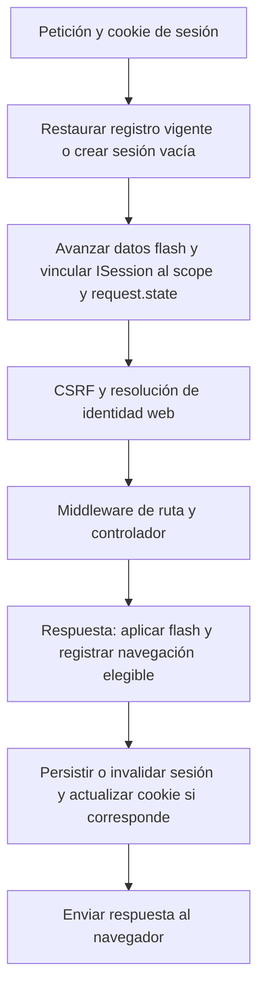

Una sesión conserva datos entre peticiones del mismo navegador. Orionis almacena el contenido en el servidor y envía al cliente una cookie con un identificador aleatorio: los valores de la sesión no se incluyen en esa cookie. Sirve para preferencias, pasos de un formulario y avisos después de una redirección.

La sesión también sostiene la autenticación web y la protección CSRF, pero guardar datos no autentica a un usuario. Para login, logout e identidades utiliza [autenticación con sesiones](/es/authentication/session-authentication).

## Cómo se integra con HTTP

Define los endpoints con estado en el archivo web configurado por `app.withRouting(web=...)`, normalmente `routes/web.py`. El pipeline web inicia la sesión antes de ejecutar los middleware de ruta y el controlador, y la guarda cuando estos devuelven su respuesta.



El almacenamiento y las cookies los coordina `StartSessionMiddleware` mediante `SessionManager`. En el controlador no necesitas llamar a `start()` ni a `save()`, crear otra instancia de sesión o registrar manualmente este middleware para una ruta web normal.

Las rutas API utilizan su propio pipeline y no restauran ni guardan una sesión automáticamente. Recibir una cookie en una ruta API no activa este ciclo. Consulta [rutas web y API](/es/http/routing) para elegir el contexto adecuado.

La sesión vacía es perezosa: una lectura aislada no genera un identificador. Sin embargo, los middleware web pueden escribir el token CSRF y la URL anterior incluso si tu controlador solo lee datos. Por ello, una visita web puede crear una sesión y enviar una cookie.

## Primer ejemplo: recordar una preferencia

Este ejemplo permite seleccionar un tema y conservarlo al recargar la página. Usa la misma cookie del navegador durante todo el recorrido.

Crea `app/http/controllers/theme_controller.py`:

```python
from orionis.http import HttpResponse, Request, response
from orionis.http.base import BaseController
from orionis.session.contracts.session import ISession
from orionis.support.facades import View


class ThemeController(BaseController):
    async def show(self, session: ISession) -> HttpResponse:
        return await View.make(
            "preferences.theme",
            theme=session.get("theme", "system"),
            notice=session.getFlash("notice"),
        )

    async def store(self, request: Request, session: ISession) -> HttpResponse:
        values = await request.formUrlEncoded()
        theme = values.get("theme")
        if theme not in ("system", "light", "dark"):
            return response.redirect("/preferences/theme", 303).withFlash(
                "notice", "Choose a supported theme."
            )

        session.put("theme", theme)
        return response.redirect("/preferences/theme", 303).withFlash(
            "notice", "Theme saved."
        )
```

Registra ambas acciones en `routes/web.py`:

```python
from app.http.controllers.theme_controller import ThemeController
from orionis.support.facades import Route


Route.get("/preferences/theme", [ThemeController, "show"])
Route.post("/preferences/theme", [ThemeController, "store"])
```

Crea `resources/views/preferences/theme.html`:

```jinja
<!doctype html>
<html lang="en">
<head>
    <meta charset="utf-8">
    <title>Theme preference</title>
</head>
<body>
    <h1>Theme preference</h1>
    
        <p role="status">{{ notice }}</p>
    
    <form method="post" action="/preferences/theme">
        
        <label for="theme">Theme</label>
        <select id="theme" name="theme">
            
                <option value="{{ value }}"
                        selected>{{ value }}</option>
            
        </select>
        <button type="submit">Save</button>
    </form>
</body>
</html>
```

Con el servidor iniciado, abre `/preferences/theme` y envía el formulario. El POST guarda `theme`, devuelve una redirección HTTP 303 y añade un aviso flash. El siguiente GET muestra la selección y el aviso; al recargar otra vez, la selección permanece y el aviso desaparece.

`` genera el campo que necesita la protección web predeterminada. `formUrlEncoded()` lee el formulario HTML; para otros cuerpos consulta [Request y payloads](/es/http/requests). La vista se renderiza mediante `await View.make(...)`, como se explica en [vistas](/es/views).

## Acceder a la sesión actual

La anotación `ISession` permite recibir la sesión activa por inyección de dependencias. También puedes utilizar `from orionis.support.facades import Session` o `request.state.session`: acceden a la misma sesión de esa petición.

Los métodos de datos, como `get()`, `put()` y `flash()`, son síncronos, incluida su llamada a través de la fachada: no llevan `await`. El acceso al almacén es asíncrono y lo realiza el middleware. Consulta [datos y formularios flash](/es/sessions/state-and-flash) para los ejemplos por constructor, método, fachada y vistas.

La sesión se vincula al scope de la petición cuando empieza el pipeline web. No la resuelvas en el arranque de un provider ni la retengas en un singleton o en tareas que sobrevivan a la petición. Un comando de consola, un servidor MCP o una conexión WebSocket no reciben automáticamente una sesión HTTP por este mecanismo.

## Elegir dónde guardar cada dato

| Necesidad | Mecanismo |
| --- | --- |
| Compartir información durante una sola petición | `request.state`. |
| Recordar una preferencia entre peticiones del navegador | `ISession.put()` y `ISession.get()`. |
| Mostrar un aviso o repoblar un formulario tras una redirección | Datos flash y helpers de formularios. |
| Conservar información de negocio de forma permanente | Tu base de datos o servicio de dominio. |
| Identificar al usuario autenticado | Los guards y servicios de autenticación. |

La configuración predeterminada usa `memory`: los registros pertenecen al proceso que atiende la petición y se pierden al reiniciarlo. Revisa el almacén antes de ejecutar varios workers o instancias.

Continúa con estas guías:

- [Datos y formularios flash](/es/sessions/state-and-flash): lectura, escritura, borrado, avisos, errores y vistas.
- [Almacenamiento](/es/sessions/stores-and-concurrency): drivers `memory`, `file`, `database` y `cache`, y peticiones concurrentes.
- [Configuración y ciclo de vida](/es/sessions/configuration-and-security): `config/session.py`, cookies, caducidad, renovación, rotación e invalidación.
