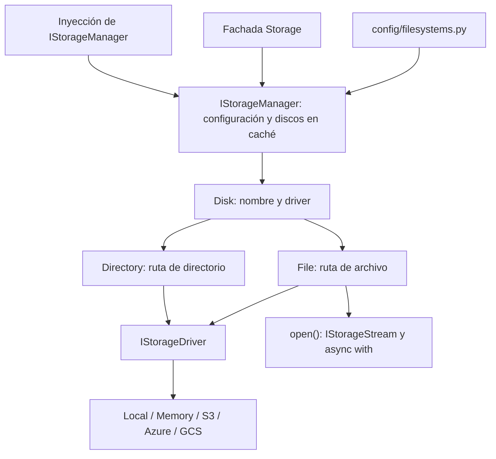

Storage ofrece una API asíncrona para guardar, leer, copiar, mover y eliminar archivos desde controladores, servicios y otros componentes de la aplicación. Trabaja con almacenamiento local, memoria, Amazon S3, Azure Blob Storage y Google Cloud Storage; las capacidades y la forma de publicar contenido dependen del driver.

## Discos, drivers y referencias

Un **disco** es una configuración con nombre: contiene la raíz local, el bucket o el contenedor y sus opciones. Un **driver** ejecuta las operaciones sobre ese medio. Dos discos pueden utilizar el mismo driver: `local` y `public` emplean el driver local con distintas raíces y publicación.



`Storage.disk()` y las referencias `disk.file(path)` y `disk.directory(path)` son síncronos. Crear una referencia no lee ni crea el archivo. Las operaciones de E/S se esperan con `await`; `readStream()` devuelve un iterador que se consume con `async for`.

## Guardar un archivo privado de la aplicación

El disco `local` funciona sin SDK ni credenciales de servicios cloud. En el `.env` de tu aplicación, antes de iniciarla:

```dotenv
FILESYSTEM_DISK=local
LOCAL_PATH=storage/app/private
```

El proceso debe poder escribir en ese directorio. `config/filesystems.py` contiene las definiciones de discos. Después del arranque, invoca la fachada desde un controlador, comando o servicio async:

```python
from uuid import UUID
from orionis.support.facades import Storage


async def save_report(report_id: UUID, content: bytes) -> str:
    file = await Storage.disk("local").put(
        f"reports/{report_id}.txt", content, visibility="private",
    )
    return file.path()
```

El resultado es una ruta lógica dentro de `reports`, no una URL HTTP. Guarda esa ruta junto a los metadatos del reporte. Para leerlo después, recupera el registro autorizado y usa `await Storage.disk("local").file(saved_path).read()`; recibirás `bytes`.

`put()` reemplaza el contenido si la ruta ya existe. El disco privado predeterminado no se sirve públicamente. Devolver una ruta no autoriza la descarga ni publica el directorio: esa política pertenece a tu aplicación.

## Elegir el siguiente paso

1. [Archivos y directorios](/es/storage/files-and-directories): guardar, leer, consultar metadatos, copiar, mover, listar y eliminar.
2. [Contenido por bloques y cargas HTTP](/es/storage/streaming-and-uploads): validar archivos subidos y procesar archivos grandes con límites explícitos de memoria.
3. [Discos y drivers](/es/storage/disks-and-drivers): discos locales/públicos, dependencias opcionales S3/Azure/GCS, credenciales, URL y extensiones.

4. [Configuración completa](/es/storage/configuration): campos, variables de entorno, validación y valores predeterminados de `config/filesystems.py`.
5. [Temporales y contextos](/es/storage/temporary-files-and-contexts): cierre, publicación y limpieza de recursos según el driver.
6. [Fachada e inyección](/es/storage/manager-and-injection): uso desde constructores y métodos y API completa de `IStorageManager`.
7. [Referencia técnica](/es/storage/api-reference): contratos, constructores, helpers, excepciones e inventario de API.

## Primer recorrido HTTP

Este controlador guarda un archivo y devuelve su ruta lógica y tamaño:

```python
from orionis.http import JSONResponse
from orionis.support.facades import Storage


class ReportController:
    async def store(self) -> JSONResponse:
        file = await Storage.disk("local").put(
            "reports/42.txt", "Report ready", visibility="private",
        )
        return JSONResponse({"path": file.path(), "size": await file.size()})
```

Guárdalo en `app/http/controllers/report_controller.py` y registra su acción en el archivo de rutas API configurado:

```python
from app.http.controllers.report_controller import ReportController
from orionis.support.facades import Route

Route.post("/storage/reports", [ReportController, "store"])
```

Un `POST /storage/reports` devuelve `{"path": "reports/42.txt", "size": 12}`. La aplicación ya registra `IStorageManager`; no necesitas registrar manualmente el provider nativo. En la guía de inyección encontrarás la alternativa con el contrato y un ejemplo completo de escritura y lectura.

## Qué esperar de la API común

Las cadenas se guardan como UTF-8 y las lecturas devuelven `bytes`. Copias y movimientos operan dentro del mismo disco; para transferir entre discos, conecta la lectura por bloques de uno con la escritura del otro. Una URL pública no concede permisos, y una URL temporal firmada no es un archivo temporal.

El manager reutiliza los discos resueltos, pero no abre una transacción entre base de datos y archivos ni una transacción general del filesystem. `async with` administra el handle; no revierte automáticamente lo escrito ante una excepción. Las guías de drivers y contextos detallan sus diferencias de publicación y memoria.
