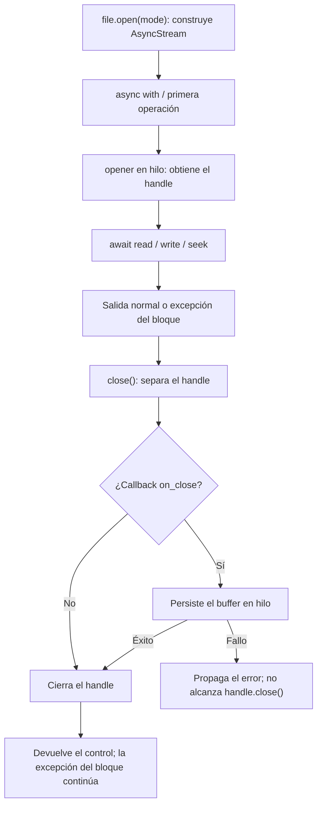

Una operación puede utilizar un temporal interno sin crear un archivo temporal visible para tu aplicación. Storage también permite guardar un archivo de trabajo en una ruta lógica y eliminarlo cuando termines. Son ciclos de vida distintos: cerrar un stream libera su handle, pero no elimina el archivo guardado en el disco.

No existe una API pública `Storage.temporaryFile()`, `tempfile()` ni un contexto temporal sobre `IFile`. `temporaryUrl()` genera una URL de acceso con vencimiento cuando el driver lo admite; no elimina el objeto al vencer. Para un archivo de trabajo utiliza las operaciones reales `file()`, `write()`/`writeStream()`, `open()` y `delete()`.

## Dónde viven los temporales

| Origen | Almacenamiento intermedio | Cuándo se libera o publica |
| --- | --- | --- |
| Escritura local con `write()`/`writeStream()` | Archivo hermano con nombre `<destino>.<16 hex>.tmp`. | Se reemplaza el destino al terminar la escritura; el staging deja de existir después del reemplazo. |
| `open()` local | El propio archivo de destino. | Se cierra su handle; el archivo y sus cambios permanecen. |
| `writeStream()` de S3, Azure o GCS | `SpooledTemporaryFile`: primero memoria, después archivo temporal del sistema al superar 8 MiB. | El SDK recibe el buffer completo y después se intenta cerrar en `finally`, también si falla la carga. |
| `open()` de S3, Azure o GCS | `SpooledTemporaryFile` con umbral de 8 MiB. | Los modos de escritura cargan el contenido completo al cerrar; después se cierra el buffer si la carga termina. |
| Memory | `bytes` almacenados por el driver; `bytearray` durante `writeStream()` y `BytesIO` durante `open()`. | Cerrar el stream persiste el buffer en el driver; el archivo permanece hasta `delete()` o hasta perder esa instancia/proceso. |
| Upload multipart HTTP | `SpooledTemporaryFile` con umbral configurado para la petición. | Se cierra al finalizar la petición o antes mediante `move()`; cerrar elimina su temporal físico si había pasado a disco. |

Los temporales de `tempfile` se ubican según la configuración del sistema operativo/Python; no se guardan necesariamente dentro de `storage/app`. La API de Storage no expone su ruta física ni el umbral cloud como argumentos de `open()` o `writeStream()`.

### Staging local y publicación

Local utiliza nombres únicos para que dos escritores no compartan su staging. `write()` crea el temporal, escribe y ejecuta un reemplazo del destino; elimina el temporal si esa secuencia produce un `OSError`. `writeStream()` escribe cada bloque en su temporal y solo reemplaza el destino cuando el productor termina normalmente.

Si el productor de `writeStream()` falla o se cancela antes de completarse, el `finally` intenta cerrar y eliminar ese staging. El reemplazo final ocurre después de ese bloque: un fallo al reemplazar no tiene la misma limpieza automática y puede dejar un `.tmp`. Un fallo al aplicar visibilidad ocurre después de publicar. Por tanto, recibir una excepción no demuestra por sí solo que el destino siga intacto.

Los listados locales de archivos omiten los nombres que terminan en `.tmp`, incluido un staging que haya quedado después de un error. La API no publica una operación para inspeccionar o purgar automáticamente esos temporales internos. No utilices ese sufijo para archivos de trabajo que necesites descubrir con `files()`.

El reemplazo evita publicar los bloques incompletos durante una escritura que falla antes del commit; no es una transacción con otras operaciones ni una garantía de durabilidad ante una interrupción del equipo. `open("wb")` no utiliza este staging: abre y trunca directamente el destino al entrar o realizar la primera operación.

### Buffers cloud

S3, Azure y GCS consumen primero todo el productor de `writeStream()` en un buffer. Este conserva los primeros 8 MiB en memoria y pasa a disco si se supera ese umbral; después se rebobina y el SDK realiza la carga. Si falla el productor, se intenta cerrar el spool antes de propagar el error. Si falla la carga, el `finally` intenta cerrarlo igualmente.

Para `open("rb")` y `open("rb+")` se descarga el objeto completo antes de entregar el handle. `ab` y `ab+` también descargan el contenido existente y sitúan el cursor al final; toleran un objeto ausente. `wb` y `wb+` comienzan con un buffer vacío. Cualquier modo distinto de `rb` vuelve a cargar el buffer completo al cerrar, incluso si no escribiste ningún byte adicional. Para lectura incremental utiliza `readStream()`.

Estas llamadas no exponen una transacción remota, una operación `abort()` de Storage ni un cambio de visibilidad mediante `open()`. Si necesitas visibilidad explícita al publicar, usa `write()`/`writeStream()` o las operaciones del archivo documentadas en la [referencia de API](/es/storage/api-reference).

## Un contexto administra un handle

`file.open(mode="rb")` es síncrono y lazy. Los drivers devuelven `AsyncStream`, que implementa `IStorageStream`; sus métodos `read`, `write`, `seek`, `close` y su contexto son asíncronos. Consulta sus [firmas y modos](/es/storage/streaming-and-uploads#stream-construction).



`async with` llama a `close()` al abandonar el bloque, tanto con éxito como con una excepción. En memory/cloud esa salida puede **publicar los bytes ya escritos aunque tu lógica haya fallado**. En local ya se modificó directamente el archivo. El contexto no interpreta la excepción como una orden de rollback.

Este ejemplo permite observar esa diferencia desde un servicio async. Tras la excepción, el archivo contiene `b"partial"`:

```python
from orionis.support.facades import Storage


async def inspect_failed_write() -> bytes:
    file = Storage.disk("local").file("work/failed-report.bin")
    try:
        async with file.open("wb") as stream:
            await stream.write(b"partial")
            raise ValueError("Report validation failed")
    except ValueError:
        return await file.read()
```

Cuando administras el stream manualmente, utiliza `try/finally` alrededor de las operaciones. `close()` es idempotente entre cierres, pero una lectura posterior puede volver a abrirlo. No hay un estado público `closed` ni un método público `flush()` para adelantar la publicación cloud.

```python
from orionis.support.facades import Storage


async def read_report_signature() -> bytes:
    stream = Storage.disk("local").file("reports/stock.csv").open("rb")
    try:
        return await stream.read(8)
    finally:
        await stream.close()
```

El stream no incorpora locks: no compartas un mismo handle entre operaciones concurrentes de lectura, escritura o cierre. Si necesitas consumidores independientes, abre un contexto para cada uno.

## Crear un archivo de trabajo y eliminarlo

Este es un helper de tu aplicación, no una función incorporada por el framework. Guárdalo en `app/services/temporary_files.py`. Usa un nombre aleatorio bajo `work/`, un disco local privado y las operaciones públicas de Storage:

```python
from collections.abc import AsyncIterable, AsyncIterator
from contextlib import asynccontextmanager
from uuid import uuid4
from orionis.storage.contracts.file import IFile
from orionis.support.facades import Storage


@asynccontextmanager
async def temporary_csv(chunks: AsyncIterable[bytes]) -> AsyncIterator[IFile]:
    file = Storage.disk("local").file(f"work/export-{uuid4().hex}.csv")
    try:
        await file.writeStream(chunks, visibility="private")
        yield file
    finally:
        await file.delete()
```

La ruta es relativa al disco; no crea un `Path` fuera de Storage. El `try` incluye la escritura y el uso del archivo. Si la escritura devuelve correctamente, el consumidor recibe un `IFile` normal; al salir, `delete()` elimina ese archivo y devuelve `False` si ya no existe. Si la escritura o el consumidor lanzan una excepción, se intenta la misma eliminación. Si `delete()` falla, su excepción también se propaga.

Puedes consumirlo desde un servicio o controlador:

```python
from app.services.temporary_files import temporary_csv


async def inspect_temporary_export() -> dict[str, int | str]:
    async def rows():
        yield b"product,quantity\n"
        yield b"keyboard,4\n"

    async with temporary_csv(rows()) as file:
        async with file.open("rb") as stream:
            header = await stream.read(16)
        return {"header": header.decode("utf-8"), "bytes": await file.size()}
```

Al devolver el resultado, primero se cierra el handle y después se elimina el archivo. No devuelvas ese `IFile` para utilizarlo más tarde: su contexto ya habrá terminado. Este patrón elimina la ruta lógica elegida por tu aplicación; no conoce ni purga los nombres internos `.tmp` que pudiera dejar un fallo durante el commit del driver.

### Mantener el temporal durante una descarga HTTP

`StreamingResponse` consume sus bloques después de que la acción devuelve el objeto de respuesta. Por eso el contexto debe estar **dentro del generador de contenido**, no alrededor de la construcción de la respuesta en el controlador:

```python
from collections.abc import AsyncIterator
from contextlib import aclosing
from app.services.temporary_files import temporary_csv
from orionis.http import StreamingResponse


class CsvExportController:
    async def download(self) -> StreamingResponse:
        async def rows() -> AsyncIterator[bytes]:
            yield b"product,quantity\n"
            yield b"keyboard,4\n"

        async def content() -> AsyncIterator[bytes]:
            async with temporary_csv(rows()) as file:
                async with aclosing(file.readStream(chunk_size=65536)) as chunks:
                    async for chunk in chunks:
                        yield chunk

        return StreamingResponse(
            content(),
            media_type="text/csv",
            headers={"Content-Disposition": 'attachment; filename="export.csv"'},
        )
```

Guarda el controlador en `app/http/controllers/csv_export_controller.py` y asocia una ruta GET a `download`, como en [streams y uploads](/es/storage/streaming-and-uploads). Los adaptadores HTTP cierran el iterador de la respuesta en su limpieza. Al cerrarse `content()`, sus contextos intentan cerrar la lectura y eliminar el archivo. No elimines el temporal justo después de `return StreamingResponse(...)`, ni abras un handle en un contexto que termine antes de transmitirlo.

Para este informe pequeño podrías producir las filas directamente en `StreamingResponse`; el archivo intermedio es útil cuando un consumidor necesita releer, buscar posiciones o comprobar el resultado antes de entregarlo.

## Excepciones, cancelación y limpieza

Distingue las garantías de cada operación:

- El cierre de `AsyncStream` ejecuta primero su callback de persistencia. Si falla, se propaga la excepción antes de llegar a `handle.close()`; un segundo `close()` no reintenta ese handle ya separado. No afirmes que una escritura remota fallida cerró inmediatamente su buffer.
- Local, S3 y GCS incluyen un `finally` para cerrar sus lectores por bloques. Agotar o cerrar explícitamente el generador permite ejecutar esa limpieza; utiliza `aclosing()` al abandonarlo antes del final. Azure delega en el iterador del SDK y no añade ese cierre explícito.
- Los drivers ejecutan I/O bloqueante con `asyncio.to_thread`. Cancelar la tarea no detiene una operación que ya corre en el hilo ni garantiza cancelar una carga del SDK. Una escritura puede continuar o terminar después de recibirse la cancelación.
- Los `finally` intentan liberar los recursos al propagarse una cancelación, pero Storage no protege toda su limpieza frente a cancelaciones repetidas ni espera de forma uniforme a todos los hilos antes de liberarlos. El helper anterior tampoco ofrece esa garantía: una nueva cancelación, un fallo de limpieza o terminar el proceso pueden dejar trabajo pendiente o un archivo de trabajo.

Mantén cada operación y su limpieza bajo el control de la misma tarea; espera su finalización antes de reutilizar/eliminar sus archivos. Si tu servicio necesita recuperación tras reinicios, conserva un registro de sus archivos de trabajo y aplica una política propia de limpieza de rutas que pertenezcan a ese servicio. Storage no les asigna un TTL ni proporciona un recolector automático.

Las excepciones de I/O o del SDK se propagan. Un error durante el cierre o la eliminación puede sustituir la excepción que había iniciado la salida del contexto; conserva ese contexto en tus registros. El helper no convierte varias operaciones en una transacción ni revierte un archivo que ya fue publicado en otra ruta.

## Vida útil del upload HTTP

`Request.form()` recibe los archivos a través del parser multipart. Su umbral de spool procede de `HTTPBodyLimits.memory_threshold`, configurado mediante `HTTP_UPLOAD_MEMORY_THRESHOLD` y con valor predeterminado de **256 KiB por archivo**. Crear directamente `orionis.http.payload.uploaded_file.UploadedFile(...)` utiliza un valor predeterminado distinto: **1 MiB**. Ninguno de esos umbrales es el tamaño máximo permitido de una carga.

El parser limita por separado los bytes recibidos, tamaño de cada parte y memoria multipart. Cuando escribir un archivo utiliza disco, su helper espera al hilo incluso ante cancelación antes de continuar con la limpieza. Si el parsing falla o se cancela, intenta cerrar las partes de archivo actuales y las ya acumuladas.

Una vez creado `FormData`, `Request.close()` cierra sus archivos mediante `FormData.close()`. El kernel lo ejecuta en `finally` después de la entrega de respuesta en los flujos ASGI y RSGI. El contexto síncrono `with form:` también los cierra al salir; no lo termines mientras otro consumidor necesite el upload.

El adaptador `Storage.uploaded(source)` referencia el mismo buffer: no prolonga su vida. `store()`, `storeAs()` y `copy()` lo mantienen abierto; `move()` guarda y después lo cierra. Persiste dentro de la petición y pasa a trabajos posteriores la ruta lógica del archivo guardado, no el objeto HTTP. Consulta [Request y payloads](/es/http/requests) y la [referencia del adaptador de uploads](/es/storage/streaming-and-uploads#upload-construction).
