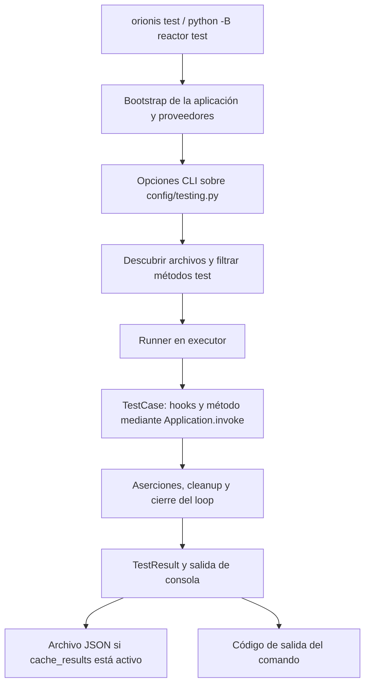

El componente de pruebas de Orionis integra el descubrimiento de casos, el contenedor de la aplicación y la ejecución asíncrona con las aserciones de `unittest`. Permite comprobar reglas, servicios e integraciones desde la misma aplicación que registra sus proveedores y configuración.

**Todos los casos deben heredar de `TestCase`, importado mediante `from orionis.test import TestCase`.** Admite métodos `def` y `async def`; el método seleccionado se ejecuta con resolución automática de dependencias. Cada caso dispone de un event loop aislado, mientras que el contenedor y los datos externos pueden seguir compartidos.

## Recorrido recomendado

| Guía | Qué aprenderás |
| --- | --- |
| [Escribir y ejecutar pruebas](/es/testing/writing-and-running-tests) | Generar un caso con `make:test`, sustituir la omisión inicial por aserciones y ejecutar archivos o métodos. |
| [TestCase y decoradores](/es/testing/cases-and-decorators) | Usar hooks, cleanups, contextos, omisiones, fallos esperados, subpruebas y mocks. |
| [Dependencias y aislamiento](/es/testing/dependency-injection) | Inyectar servicios, resolverlos en fixtures y controlar scopes y recursos persistentes. |
| [Resultados y configuración](/es/testing/results-and-reference) | Configurar `config/testing.py`, elegir verbosidad, filtrar la suite y guardar resultados JSON. |

Las [pruebas de Database y ORM](/es/database/orm/testing) y las [pruebas MCP](/es/testing/mcp-testing) conservan sus guías específicas en los menús de esos componentes.

## Flujo de ejecución



El runner usa un loop por caso para ejecutar y limpiar operaciones asíncronas; no necesitas `asyncio.run()` dentro de los métodos. Los decoradores de omisión y fallos esperados proceden de `unittest`: Orionis no exporta decoradores propios de pruebas.

La ejecución normal se inicia desde la raíz del proyecto:

```shell
python -B reactor test
```

También puedes ejecutar `orionis test` o `uv run python -B reactor test`. No necesitas instalar otro runner para utilizar este componente. Ejecutar directamente los casos con `unittest.main()` no arranca la aplicación de Orionis para su inyección.

## Configurar el entorno de la suite

`config/testing.py` define seis opciones: verbosidad, fail-fast, directorio inicial, patrón de archivos, patrón de métodos y persistencia de resultados. El comando permite sustituir las opciones de ejecución correspondientes. El JSON se guarda en disco; no existe un flag `--json` para convertir stdout en un reporte JSON.

El comando no elige automáticamente otra base de datos ni cambia `APP_ENV` a `testing`. Prepara la configuración y los recursos de prueba antes del bootstrap. Heredar de `TestCase` tampoco activa rollback, limpieza de archivos o un scope independiente del contenedor por caso; organiza esa limpieza con los mecanismos documentados.

La [referencia de fuentes y API](/downloads/testing-api-inventory.json) distingue las declaraciones propias de Orionis de las herramientas heredadas de `unittest`. Empieza por [crear tu primera prueba](/es/testing/writing-and-running-tests).
