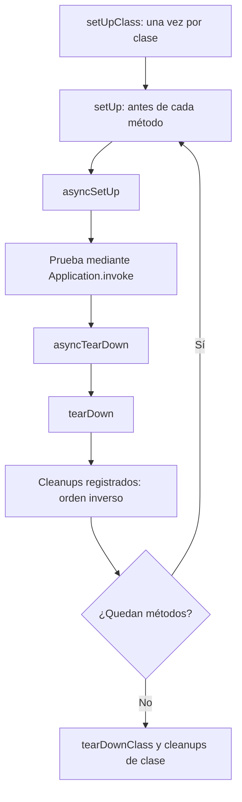

## La clase base de todas las pruebas

Todos los casos de prueba de una aplicación Orionis deben heredar de `TestCase`, importado desde el paquete público:

```python
from orionis.test import TestCase


class TestTotals(TestCase):
    def testAddition(self) -> None:
        self.assertEqual(2 + 3, 5)

    async def testAsyncCalculation(self) -> None:
        async def calculate() -> int:
            return 2 + 3

        self.assertEqual(await calculate(), 5)
```

Guárdalo en `tests/unit/test_totals.py` y ejecútalo mediante [el comando de pruebas](/es/testing/writing-and-running-tests). El runner arranca la aplicación; ejecutar directamente estos casos con `unittest.main()` no proporciona ese arranque.

`TestCase` extiende `unittest.IsolatedAsyncioTestCase`: admite `def` y `async def`, conserva las aserciones de Python y crea un event loop aislado para cada método ejecutado. No llames a `asyncio.run()` dentro de una prueba; utiliza `await`. Devuelve `None` y comunica el resultado mediante aserciones o excepciones.

La instancia del caso se construye con `TestCase(method_name="runTest")`. El loader proporciona el nombre del método; ese constructor no es un punto de inyección de dependencias. Conserva el constructor heredado y utiliza los hooks para preparar cada prueba.

## Ciclo de vida

Con preparación y ejecución satisfactorias, el orden es:



| Hook | Firma que se implementa | Uso |
| --- | --- | --- |
| `setUp` | `def setUp(self) -> None` | Preparar valores y recursos síncronos para un método. |
| `asyncSetUp` | `async def asyncSetUp(self) -> None` | Abrir recursos que requieren `await`. Se ejecuta después de `setUp`. |
| `asyncTearDown` | `async def asyncTearDown(self) -> None` | Finalizar recursos asíncronos después de la prueba. |
| `tearDown` | `def tearDown(self) -> None` | Limpieza síncrona después de `asyncTearDown`. |
| `setUpClass` | `@classmethod def setUpClass(cls) -> None` | Preparación síncrona compartida por la clase. |
| `tearDownClass` | `@classmethod def tearDownClass(cls) -> None` | Limpieza síncrona de esa preparación. |

Los seis hooks conservan sus firmas de `unittest` y **no reciben inyección automática**. Si `setUp` o `asyncSetUp` falla, no se ejecutan el método ni el teardown de esa prueba; sí se intentan sus cleanups registrados. Si la preparación termina, un fallo de la prueba no impide intentar el teardown. Los errores en hooks por caso se registran como errores de la prueba. Los fallos previos al primer caso en hooks de clase tienen una limitación específica del procesador, descrita en [resultados](/es/testing/results-and-reference).

El loop se cierra al finalizar el caso y cancela las tareas que sigan pendientes. Esto no sustituye cerrar explícitamente conexiones, streams u otros recursos.

Estas herramientas se heredan de [`unittest.IsolatedAsyncioTestCase`](https://docs.python.org/3.14/library/unittest.html#unittest.IsolatedAsyncioTestCase); Orionis incorpora la invocación del método mediante el contenedor.

### Preparar y limpiar recursos

Este archivo completo utiliza una fixture asíncrona y un directorio temporal. `addAsyncCleanup` registra la función, sin ejecutarla ni necesitar `await` en ese momento:

```python
from pathlib import Path
from tempfile import TemporaryDirectory

from orionis.test import TestCase


class AsyncBuffer:
    def __init__(self) -> None:
        self.closed = False
        self.values: list[str] = []

    async def write(self, value: str) -> None:
        if self.closed:
            raise RuntimeError("Buffer is closed")
        self.values.append(value)

    async def close(self) -> None:
        self.closed = True


class TestExport(TestCase):
    def setUp(self) -> None:
        directory = TemporaryDirectory()
        self.addCleanup(directory.cleanup)
        self.directory = Path(directory.name)

    async def asyncSetUp(self) -> None:
        self.buffer = AsyncBuffer()
        self.addAsyncCleanup(self.buffer.close)

    async def testExport(self) -> None:
        await self.buffer.write("ready")
        target = self.directory / "export.txt"
        target.write_text(self.buffer.values[0], encoding="utf-8")
        self.assertEqual(target.read_text(encoding="utf-8"), "ready")
```

Los cleanups se ejecutan después del teardown, en orden inverso al registro: primero se cierra el buffer y después se elimina el directorio. Al registrar la limpieza inmediatamente después de adquirir un recurso, este también puede liberarse si falla una preparación posterior.

### Métodos para gestionar recursos

Las firmas siguientes omiten `self` y `cls`:

| Método heredado | Resultado y comportamiento |
| --- | --- |
| `addCleanup(function, /, *args, **kwargs)` | Registra una limpieza síncrona para la prueba; devuelve `None`. |
| `addAsyncCleanup(func, /, *args, **kwargs)` | Registra una limpieza asíncrona para la prueba; devuelve `None`. |
| `enterContext(cm)` | Entra en un contexto síncrono, registra su salida y devuelve el valor de `__enter__`. |
| `await enterAsyncContext(cm)` | Hace lo mismo con un contexto asíncrono y devuelve el valor de `__aenter__`. |
| `doCleanups()` | Ejecuta anticipadamente las limpiezas pendientes de la prueba. El runner también lo llama al terminar. |
| `addClassCleanup(function, /, *args, **kwargs)` | Registra una limpieza síncrona de clase. |
| `enterClassContext(cm)` | Entra en un contexto síncrono de clase y registra su salida. |
| `doClassCleanups()` | Ejecuta anticipadamente las limpiezas pendientes de la clase. |

Por ejemplo, `self.directory = Path(self.enterContext(TemporaryDirectory()))` reemplaza las tres líneas de creación y registro del directorio del ejemplo anterior. Para un contexto asíncrono, usa `resource = await self.enterAsyncContext(context_manager)`.

La preparación de un módulo completo también puede usar funciones síncronas `setUpModule()` y `tearDownModule()`, sin parámetros inyectados. Para datos o conexiones vinculados al loop de una prueba, utiliza `asyncSetUp` y `addAsyncCleanup` en el caso correspondiente.

Consulta la [guía de inyección de dependencias y aislamiento](/es/testing/dependency-injection) para recibir servicios en el método, resolverlos en hooks y abrir scopes explícitos.

## Decoradores admitidos

Orionis no define ni exporta decoradores propios de pruebas. Los decoradores de control del resultado proceden de `unittest`; impórtalos explícitamente. Son compatibles con métodos `def` y `async def`:

| Decorador | Cuándo utilizarlo |
| --- | --- |
| `@skip(reason)` | Omitir una prueba o clase e indicar el motivo. |
| `@skipIf(condition, reason)` | Omitirla cuando una condición es verdadera. |
| `@skipUnless(condition, reason)` | Ejecutarla solo si la condición es verdadera. |
| `@expectedFailure` | Marcar un fallo conocido que se espera reproducir dentro del método de prueba. |

El siguiente módulo muestra los cuatro, sin depender de variables de entorno ni de servicios externos:

```python
import sys
from unittest import expectedFailure, skip, skipIf, skipUnless

from orionis.test import TestCase


class TestCompatibility(TestCase):
    @skip("Example requiring an external test fixture")
    def testExternalFixture(self) -> None:
        self.fail("This body is not executed")

    @skipIf(sys.platform == "win32", "Unix-only path example")
    async def testUnixPath(self) -> None:
        self.assertNotEqual(sys.platform, "win32")

    @skipUnless(sys.platform == "win32", "Windows-only path example")
    def testWindowsPath(self) -> None:
        self.assertEqual(sys.platform, "win32")

    @expectedFailure
    async def testKnownDefect(self) -> None:
        self.assertEqual("actual", "expected")
```

Los tres decoradores de omisión también admiten una clase completa. Un método omitido no ejecuta sus fixtures por prueba; una clase omitida tampoco ejecuta sus fixtures de clase. `self.skipTest(reason)` permite decidir dentro del método o de su preparación.

`expectedFailure` no convierte un error de `setUp` o teardown en un fallo esperado. En los resultados de Orionis, un fallo esperado se exporta como `SKIPPED`; si el método pasa inesperadamente, se exporta como `FAILED` y el comando termina con error. Retira la marca cuando corrijas el defecto.

## Aserciones, excepciones y subpruebas

Utiliza las aserciones heredadas para explicar qué condición debe cumplirse. Por ejemplo, `assertEqual`, `assertTrue`, `assertIsNone`, `assertIsInstance`, `assertIn`, `assertCountEqual` y `assertAlmostEqual` cubren valores, identidad, pertenencia y comparaciones numéricas. No necesitas importar funciones `assert*` adicionales.

`assertRaises` también funciona alrededor de una operación con `await`. `subTest` permite recorrer entradas distintas conservando el dato que produjo el fallo:

```python
from orionis.test import TestCase


async def parseQuantity(value: str) -> int:
    return int(value)


class TestQuantities(TestCase):
    async def testValidQuantities(self) -> None:
        for text, expected in [("0", 0), ("12", 12)]:
            with self.subTest(text=text):
                self.assertEqual(await parseQuantity(text), expected)

    async def testInvalidQuantity(self) -> None:
        with self.assertRaises(ValueError) as captured:
            await parseQuantity("invalid")
        self.assertIsInstance(captured.exception, ValueError)
```

Una `AssertionError` se registra como fallo; otra excepción no esperada, como error. Una subprueba fallida produce un resultado con su identificador parametrizado. Las subpruebas aprobadas no generan registros individuales adicionales. `assertWarns`, `assertLogs` y `assertNoLogs` también están disponibles por herencia cuando necesites verificar advertencias o registros compatibles con el logging de Python.

## Dobles de prueba

`unittest.mock` permite sustituir colaboradores. Los contextos `patch.object(...)` mantienen explícito el reemplazo sin añadir parámetros a la firma que Orionis analiza para inyectar dependencias:

```python
from unittest.mock import AsyncMock, patch

from orionis.test import TestCase


class NotificationGateway:
    async def send(self, recipient: str) -> str:
        raise RuntimeError("Real transport must be configured")


class TestNotifications(TestCase):
    async def testSend(self, gateway: NotificationGateway) -> None:
        fake = AsyncMock(return_value="accepted")

        with patch.object(gateway, "send", new=fake):
            result = await gateway.send("user@example.com")

        self.assertEqual(result, "accepted")
        fake.assert_awaited_once_with("user@example.com")
```

No asumas que un decorador arbitrario que cambia la firma mantiene la inyección: `patch` como decorador puede añadir argumentos propios. Para métodos con dependencias inyectadas, el contexto del ejemplo evita esa interacción. [La referencia de `unittest.mock`](https://docs.python.org/3.14/library/unittest.mock.html) describe sus otras formas de parcheo.

## Utilidades específicas de TestCase

### `setMethodPattern(pattern: str) -> None`

Método de clase que establece el patrón glob que decide qué método seleccionado debe envolverse con la invocación de la aplicación. Su predeterminado es `test*` y el valor pertenece al contexto actual. El motor lo actualiza mediante `setMethodPattern(...)`; úsalo desde la [configuración y ejecución de pruebas](/es/testing/writing-and-running-tests).

No modifica por sí solo el prefijo de descubrimiento de `unittest.TestLoader`: el comando sigue cargando métodos que empiezan por `test`. Mantén ese prefijo y usa patrones como `testCreate*` para seleccionar un subconjunto. Los hooks de ciclo de vida y los métodos privados nunca se envuelven.

### `await mcp(server, config=None, *, app=None) -> McpTestClient`

Crea un cliente MCP en proceso para una clase de servidor o un servidor ya compilado. Reutiliza la aplicación arrancada por el runner, salvo que proporciones otro contenedor mediante `app=`. `config` admite una configuración `McpConfig`; si se omite se usan los valores predeterminados del cliente.

Las llamadas del cliente abren sus propios scopes; ese aislamiento pertenece al cliente MCP. Consulta los ejemplos completos de [pruebas de servidores MCP](/es/mcp/testing).

Continúa con [ejecución y descubrimiento](/es/testing/writing-and-running-tests) y [configuración y resultados](/es/testing/results-and-reference).
