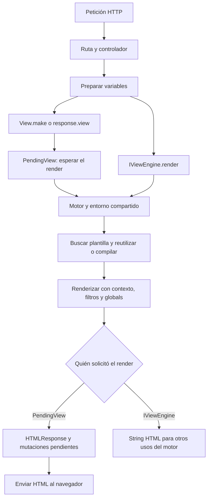

Las vistas generan HTML en el servidor a partir de una plantilla y los datos que proporciona tu aplicación. Orionis integra Jinja2 con su contenedor, las respuestas HTTP, la sesión y los helpers del framework. El motor usa renderizado asíncrono y permite esperar servicios asíncronos desde las plantillas sin escribir `await` en ellas.

El código del motor se encuentra en `orionis/view`. Las plantillas de tu aplicación se crean por defecto en `resources/views`; la configuración de `config/view.py` permite añadir o cambiar directorios. Las vistas no contienen la lógica que consulta datos o autoriza una operación: prepara esa información en el controlador o sus servicios y pasa el contexto necesario.

## Tu primera página

Crea manualmente `resources/views/pages/welcome.html`:

```jinja
<!doctype html>
<html lang="en">
<head>
    <meta charset="utf-8">
    <meta name="viewport" content="width=device-width, initial-scale=1">
    <title>{{ page_title }}</title>
</head>
<body>
    <h1>{{ page_title }}</h1>
    <ul>
        
            <li>{{ feature }}</li>
        
    </ul>
</body>
</html>
```

En `app/http/controllers/welcome_page_controller.py`:

```python
from orionis.http import HTMLResponse
from orionis.http.base import BaseController
from orionis.support.facades import View


class WelcomePageController(BaseController):
    async def __call__(self) -> HTMLResponse:
        return await View.make(
            "pages.welcome",
            page_title="Welcome to Orionis",
            features=["Async rendering", "Layouts", "Template helpers"],
        )
```

Registra una ruta en `routes/web.py`, cargado por tu configuración existente `app.withRouting(web="routes/web.py", ...)`:

```python
from app.http.controllers.welcome_page_controller import WelcomePageController
from orionis.support.facades import Route

Route.get("/welcome-page", WelcomePageController)
```

Con la aplicación iniciada, abre `http://localhost:8000/welcome-page` o la dirección que indique la consola. Orionis busca `pages/welcome.html`, incorpora `page_title` y `features` al contexto y devuelve una respuesta HTML. Los valores ordinarios se escapan con la configuración predeterminada.

`pages.welcome` es un identificador de Orionis; `pages/welcome.html` es la ruta de la plantilla. Los puntos se convierten en directorios cuando el identificador no contiene `/`. Dentro de `extends`, `include` e `import` se usan los nombres de archivo de las plantillas. La [guía de plantillas](/es/views/template-language) explica esas diferencias.

## Respuesta HTTP o HTML como texto

| Necesidad | API | Resultado |
| --- | --- | --- |
| Devolver una página al navegador | `return await View.make("pages.welcome", **data)` | `HTMLResponse` con el HTML renderizado. |
| Utilizar el builder HTTP | `return await response.view("pages.welcome", **data)` | El mismo flujo de vistas. |
| Obtener el contenido para otro uso | `await engine.render("pages.welcome", data)` con `IViewEngine` inyectado | `str` con el HTML, sin crear una respuesta HTTP. |

`View.make()` prepara un `PendingView`: el trabajo ocurre al esperarlo. Su método `render()` también devuelve `HTMLResponse`; para obtener un string utiliza el motor, no un supuesto método `View.render()`. Los ejemplos completos de variables, controladores, cabeceras y HTML para guardar están en [Controladores y HTML](/es/views/rendering-templates).

## Organizar y extender las plantillas

Una estructura habitual es:

```text
resources/views/
├── layouts/base.html
├── pages/welcome.html
├── partials/navigation.html
└── macros/forms.html
```

Son directorios elegidos para organizar tus archivos, sin registros automáticos de componentes. Un layout define bloques; las páginas lo extienden, los parciales se incluyen y las macros encapsulan fragmentos reutilizables. Consulta [Plantillas y herencia](/es/views/template-language).

El entorno incluye **56 filtros** —54 estándar y 2 de Orionis—, **36 nombres globales** —30 de Orionis y 6 estándar— y la extensión ``. Los catálogos incluyen un ejemplo de cada filtro y global; no necesitas abrir el código fuente para conocer su uso.

- [Filtros](/es/views/filters): transformaciones, formato, colecciones, JSON, Markdown y escape.
- [Globals y contexto](/es/views/globals): rutas, assets, sesión, formularios, traducciones y otros helpers.
- [Providers y extensiones](/es/views/providers-and-extensions): filtros, globals, tests y tags propios, registrados durante el arranque.

## Configuración y caché

`config/view.py` configura dónde buscar plantillas, cuántas conservar en memoria, dónde guardar bytecode, cuándo recargar archivos y cómo escapar HTML. La caché de bytecode se crea por defecto en `storage/framework/views` y conserva plantillas compiladas, no el HTML final ni los datos de cada usuario.

La caché en memoria y la de disco son independientes. Usarlas reduce trabajo repetido de carga o compilación según la capa; no sustituye la generación de HTML con los datos de cada petición. La guía de [Configuración y caché](/es/views/configuration-and-cache) explica las opciones, sus valores reales y `orionis clear:views`.

## Flujo de renderizado



El renderizado async permite esperar callables asíncronos, pero no convierte automáticamente una función bloqueante en una operación no bloqueante. Ejecuta consultas y trabajo de negocio en servicios antes de renderizar, y mantén el entorno compartido estable durante las peticiones.

Las traducciones siguen disponibles desde los globals, con su documentación en [Traducciones](/es/localization). Para formatos HTTP, cookies o descargas, consulta [Respuestas](/es/http/responses).
